# Mathstone

수학 개념과 수학자로 싸우는 카드 게임.

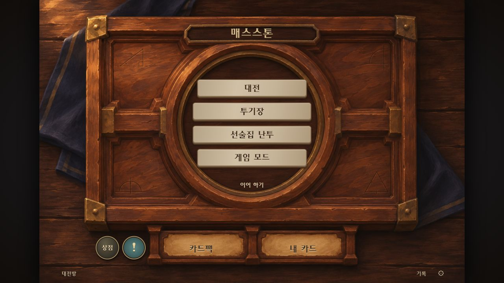

## 실행

Node.js 설치 후:

```sh
npm start
```

[http://127.0.0.1:4173](http://127.0.0.1:4173) 접속.

Windows에서는 `Play-Mathstone.cmd`를 더블클릭해도 됩니다.

## 게임 화면

### 전투

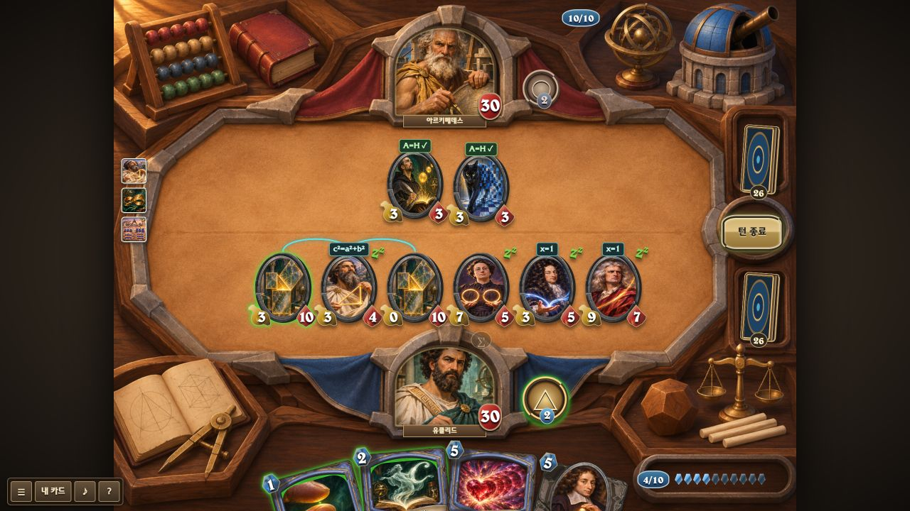

| 대전 준비 | 카드 서고 · 덱 편집 |
| --- | --- |
| 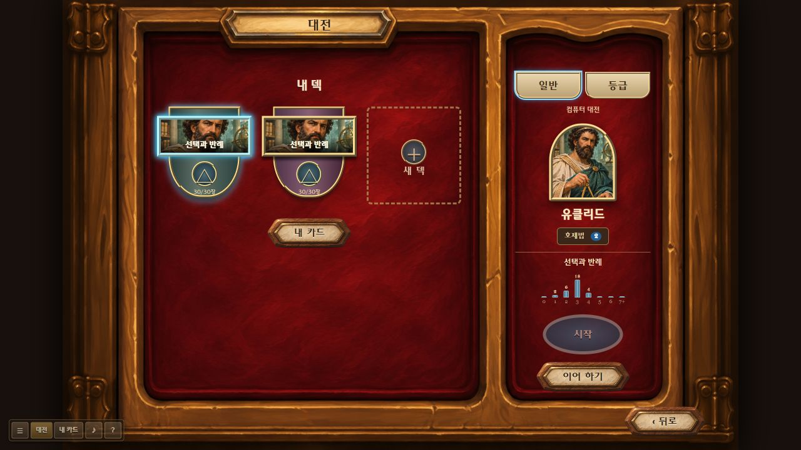 | 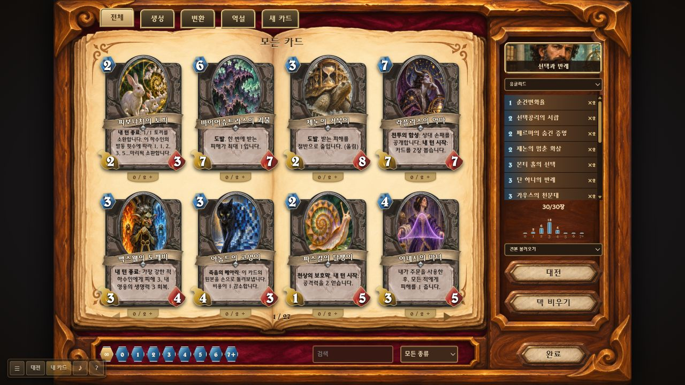 |

| 상점 | 카드팩 개봉 |
| --- | --- |
| 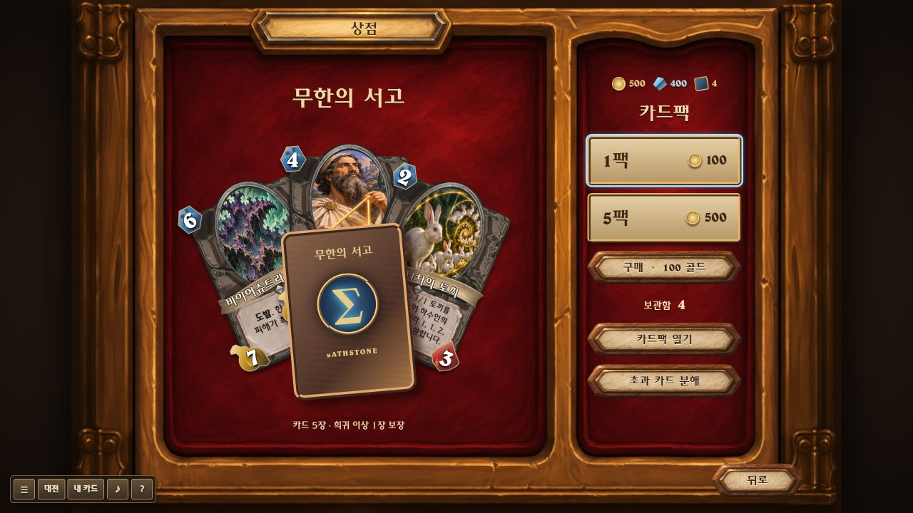 | 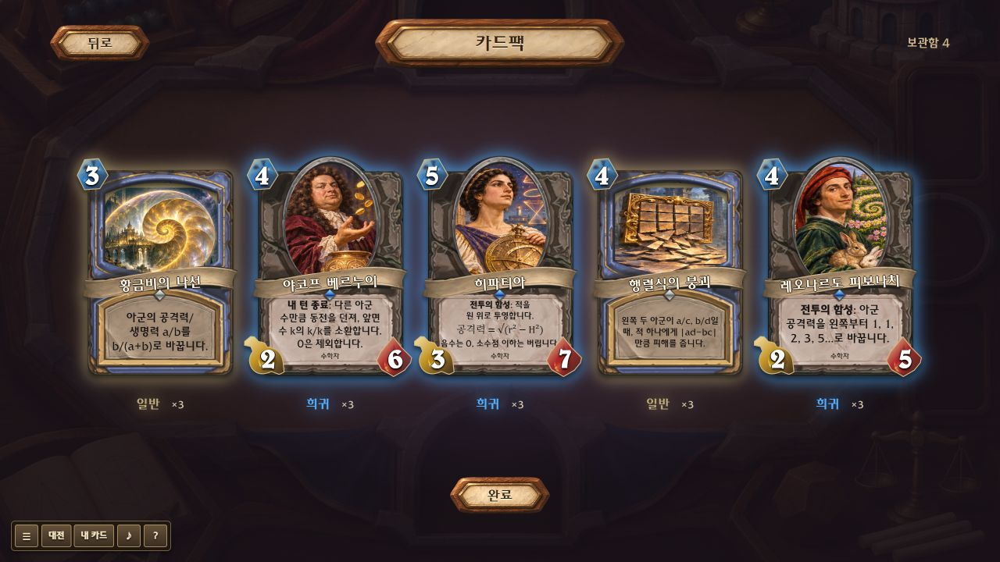 |

| 투기장 | 새 덱 |
| --- | --- |
| 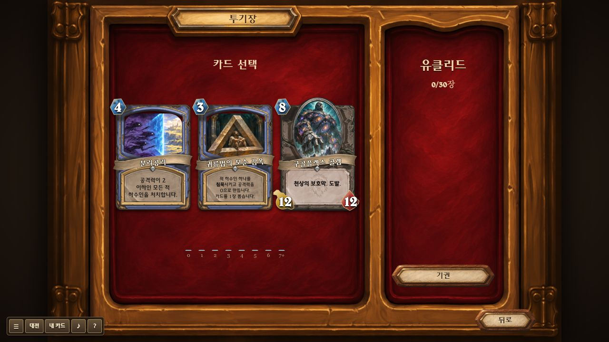 | 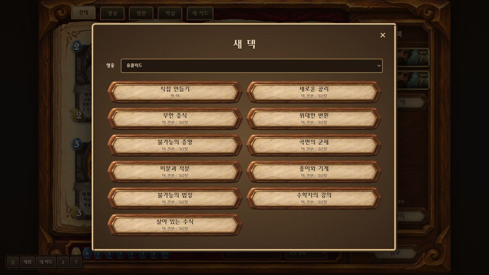 |

### 수학 능력

| 몬티 홀 · 문 유지 또는 교체 | 푸리에 · 증폭할 주파수 선택 |
| --- | --- |
| 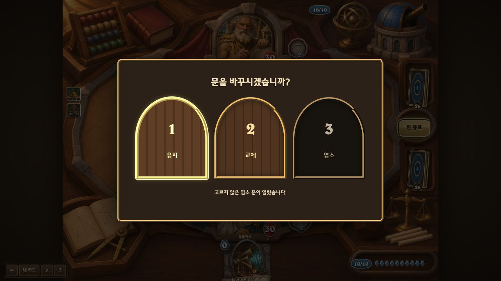 | 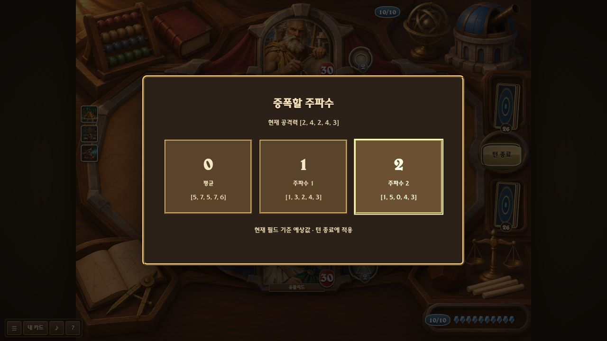 |

### 작은 화면

| 메인 메뉴 | 카드 서고 | 카드 규칙 |
| --- | --- | --- |
| 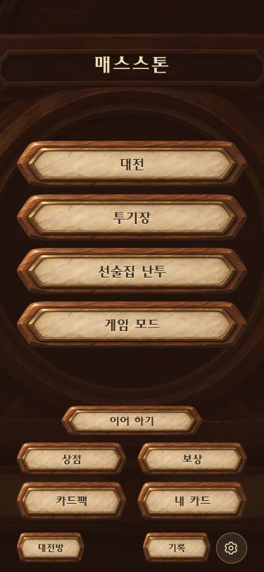 | 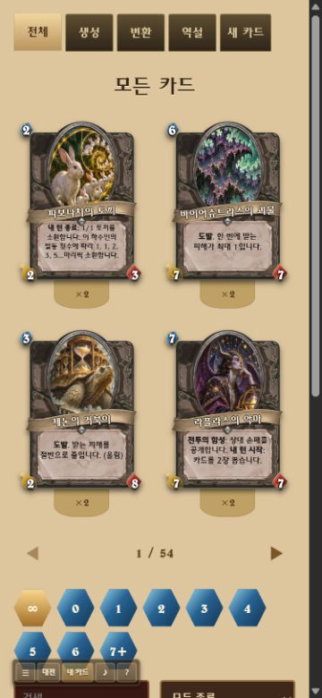 | 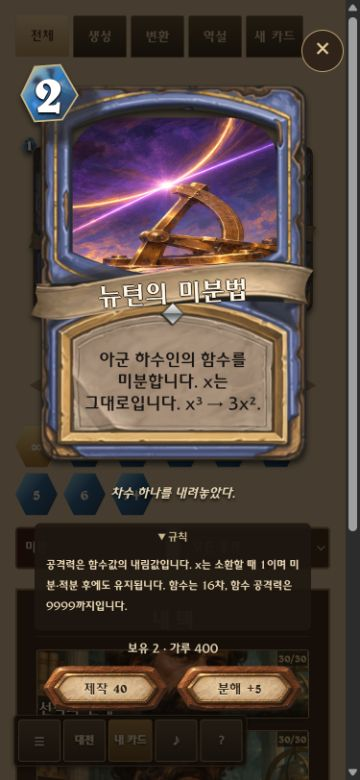 |
