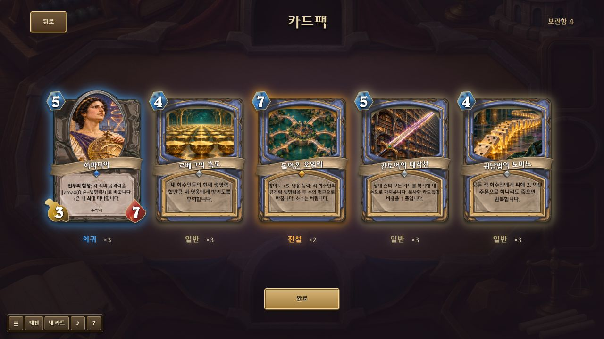
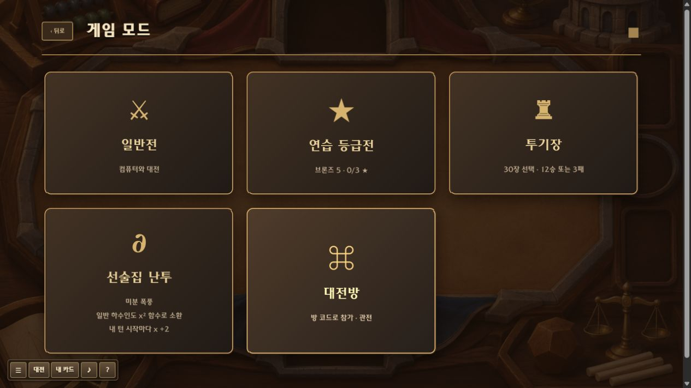
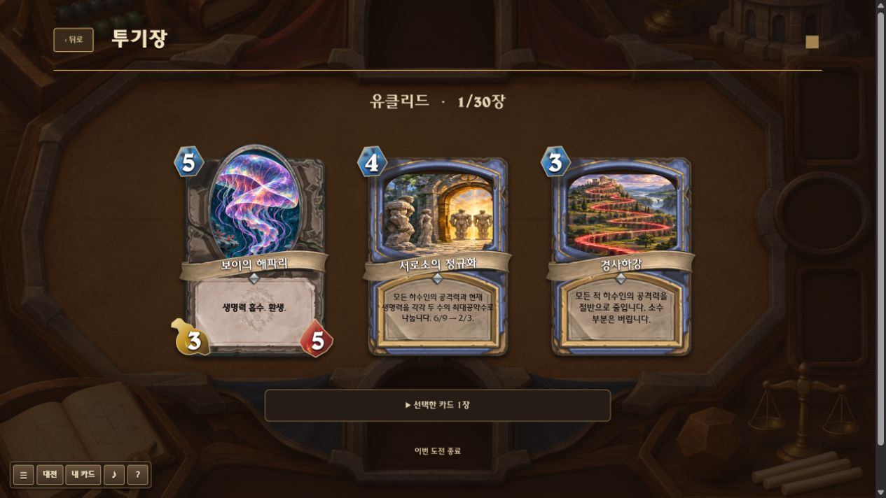
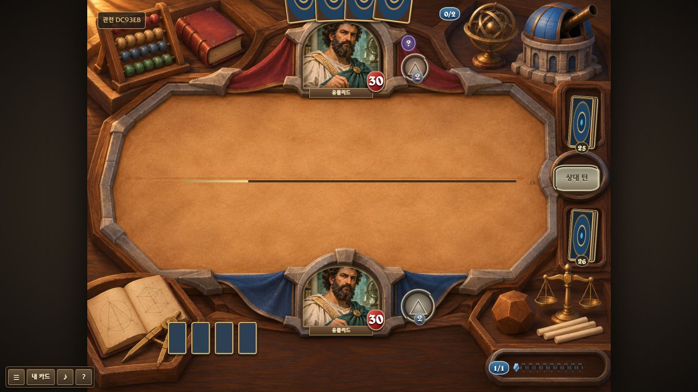

# 수학 능력과 수집·대전 시스템 구현

2026-11-09. 문서 12의 모든 제안을 구현했다는 뜻은 아니다. 문서 13은 당시 210종의 스냅샷이며 현재 카드는 214종이다.

## 실제 수학 연산

| 카드 | 규칙과 예 |
|---|---|
| 피타고라스 | 좌우 하수인과 연결. 3과 4이면 5. 입력 4가 0이 되면 즉시 3 |
| 블레즈 파스칼 | 두 입력의 합. 위치·진영이 바뀌어도 같은 개체를 따라감 |
| 알콰리즈미 | 공격력=현재 생명력이어야 공격 가능. 6/9에 호제법을 쓰면 3/3으로 조건 충족 |
| 에미 뇌터 | Σ → 아군 지정. 오라를 제외한 공격력을 뇌터에게 이전. 합 보존, 턴마다 한 번 |
| 변수의 전진·역행 | 함수 입력 x를 ±1. x=0에서 역행 불가 |
| 합성함수의 고리 | 왼쪽 g=x+2를 f=x²에 넣으면 x²+4x+4. 대상의 x 유지 |
| 상수항의 탈출 | x²+3 → x²와 3/3 하수인. 양의 정수 상수·빈 필드 칸 필요 |

연결의 없는 쪽·떠난 개체는 0이다. 침묵하면 연결이 제거된다. 연결된 공격력은 직접 강화보다 식이 우선하며 뇌터의 이전 대상으로 고르지 않는다. 함수는 기약분수로 계산하고 기존 16차/함수 기본 공격력 9999 한도는 유지한다.

전장에 수식 배지·연결선·등식 충족 상태를 표시한다. 추천 덱 **살아 있는 수식**을 추가했다. 신규 주문 4장은 기존 그림을 재사용한다.

## 수집과 보상

- 최초 지급: 편성 수량(일반 2/전설 1), 5팩, 500골드, 400가루. 이전 덱을 유지하기 위한 초기값이다.
- 팩당 5장. 일반70/희귀22/특급6/전설2% 티어 추첨 후 카드 풀에서 선택. 비어 있는 티어는 희귀로 대체한다. 첫 네 장이 모두 일반이면 마지막은 희귀. 중복 보호·천장 없음.
- 개봉 시작 시 팩 차감·카드 지급을 한 번 처리한다. 공개 위치까지 저장하며 재접속해도 중복 지급하지 않는다.
- 제작/분해 가루: 일반40/5, 희귀100/20, 특급400/100, 전설1600/400. 저장 덱의 최대 필요 수량을 보호한다. 일괄 분해는 2장/전설1장도 남긴다.
- 상점: 1팩100골드, 5팩500골드. 현금 결제 없음. 무료 팩 버튼 유지.
- 일일 퀘스트: 카드10장 사용, 1승, 2팩 개봉. 각 50골드·100XP. 로컬 날짜 기준.
- 업적: 첫 승리, 10경기, 5팩, 주문20회, 첫 제작. 각 1팩·100XP.
- 보상의 길: 200XP마다 100골드, 3의 배수 레벨은 추가1팩. 미수령 레벨부터 표시.
- 대전 종료: 승리100XP·30골드·1팩, 그 외40XP. 최근 50경기의 대전 ID로 중복 처리를 막는다.

## 모드와 접속 범위

- 일반전: 기존 AI 대전.
- 연습 등급전: 승리 별+1/패배−1, 0 미만 제외. 브론즈부터 전설까지 로컬 진행, 시즌·MMR 없음.
- 투기장: 영웅 선택 후 3택1을30번. 영웅·중복 제한 적용, 후보와 선택 저장. 12승/3패 또는 중도 종료. 보상50+25×승수 골드, 1+⌊승수/4⌋팩. 무료 입장.
- 미분 폭풍: 기존 함수가 없는 일반 하수인도 x² 함수. 자기 턴 입력 증가2. 원래 능력 유지.
- 대전방: 서버가 두 사람의 멀리건·행동·턴 판정. 90초 제한, 코드 참가·재접속·관전. 상대 손패·덱 순서·비밀·선택지·난수 시드를 가린 후 전달.

친구 수첩은 방 코드와 이름의 로컬 목록이다. 방은 메모리에만 존재하며 서버 재시작 시 사라진다. 기본 루프백 서버이며 공개 배포하지 않았다. 공개 서비스에는 계정·영구 저장·요청 제한·운영 보호 등이 별도로 필요하다.

## 검증

- 전체 자동 테스트 **317개 통과**. 로그: `art-work/full-systems-tests.txt`.
- 수학: 연결 3/4→5, 뇌터 이전에 따른 연결식 갱신, 합성, 등식 봉인 해제, 복사·침묵·저장·입력 경계.
- 팩: 개별 공개 후 새로고침 복원, 전체 공개, 완료, 수량 반영.
- UI: 1팩 구매(골드500→400), 토끼 제작(2→3장/가루400→360), 분해(3→2장/가루360→365), 업적 수령·중복 버튼 비활성.
- 투기장: 1장 선택 후 같은 후보 복원, 30장 완성, 멀리건, 항복 후0승1패, 종료·보상.
- 세 탭: 방 생성, 두 사람 독립 멀리건, 턴 교환, 게스트 동전·비밀 사용, 새로고침 후 재접속, 관전 정보 가림, 방 나가기 후 상대 승리.
- 1280×720와575×900 모드/드래프트 화면 확인. 브라우저 오류 로그 없음. 테스트 저장 데이터 복원.

실제 휴대폰·외부 인터넷 미검증. 밸런스 조정·계정·자동 매칭·원작 모든 별도 모드·카드 음성·전체 리플레이는 포함하지 않는다. [남은 차이](10_원작대비_차이와_누락.md).
