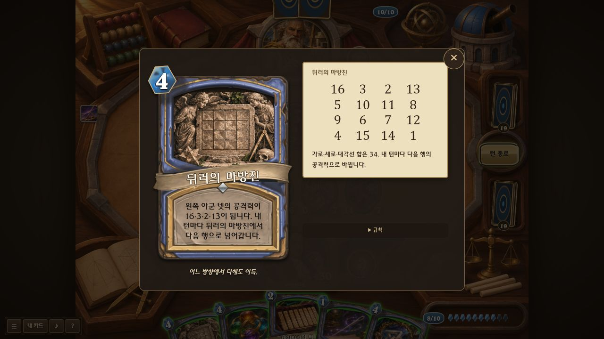
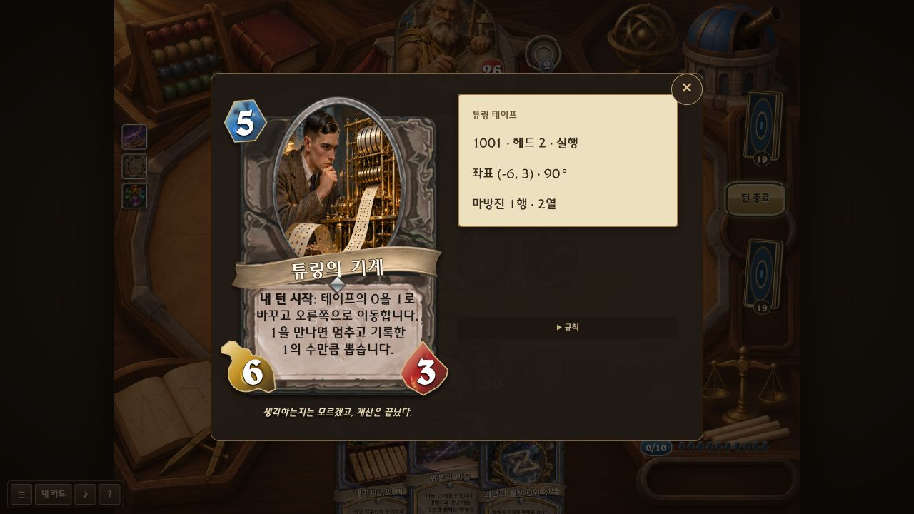

# 카드별 수학적 정체성 검토 — 214장

2026-11-09. 이번 작업은 **33장 실제 개편**, **89장 유지**, **92장 추가 설계**다. 아래에서 ‘설계 · 미구현’은 아직 플레이할 수 있는 능력이 아니다. 같은 연산의 대상·범위만 다른 카드도 있으므로 214장이 모두 독립적인 새 알고리즘이라는 뜻은 아니다.

## 판단 기준

- 이름을 가리고도 수열·공간·논리·확률·함수의 성격이 플레이에 남는가.
- 고정 피해나 버프에 유명한 이름만 붙인 카드는 개편 대상으로 분류한다.
- 기본 연산은 단순해도 유지한다. 대신 무엇을 바꾸는지와 적용 시점이 구별되어야 한다.
- 계산식과 진행 상태는 상세창, 카드 앞면은 실제 행동 설명, 플레이버 문구는 별도로 둔다.
- 테일러는 정확 복사, 호텔은 실제 필드 확장이라는 사용자 요구를 유지한다. 밸런스 조정은 범위에서 제외한다.

## 먼저 드러난 중복

라이프니츠·뉴턴·코시·라그랑주·페르마·오일러는 현재 서로 다른 다항식을 가진 같은 성장 틀이다. 각 인물의 새 설계는 각각 곱의 미분법·뉴턴 반복·수열 수렴·보간·정수 방정식·그래프 불변량으로 나눴다. 이 여섯 인물의 새 능력은 이번 구현에 포함되지 않았다.

순환치환·좌표 교환·GCD·복제 계열도 반복된다. 기본 주문과 지속 관계·직접 선택·진행 상태 복사를 구분하고, 이름만 겹친 무기·장소는 추가 설계 대상으로 남겼다.

## 구현된 33장의 공통 동작

복제는 현재 테이프·좌표·마방진 행·연결 대상까지 복사한다. 침묵은 새 표식과 상태를 제거한다. 저장과 온라인 좌석 전환에도 개체 UID와 상태를 유지한다. 카드의 최대 칸 수 13, 손패 10, 일반 전투 종료 제한은 그대로 적용한다. 수학적 무한은 유한 단계로 실행하며 수치 상한·반올림은 카드 상세 규칙에 적는다.

## 전체 목록

### 001. 피보나치의 토끼 — 유지

ID: `rabbit`

- 현재 구현: 내 턴 종료: 1/1 토끼를 소환합니다. 이 하수인의 발동 횟수에 따라 1, 1, 2, 3, 5…마리씩 소환합니다.
- 유지 이유·주의점: 발동 횟수별 피보나치 수열이 실제 소환 수가 된다. 토끼를 복사하면 현재 수열 위치까지 이어받는 조합을 유지한다.

### 002. 바이어슈트라스의 괴물 — 개편 구현

ID: `monster`

- 변경 전: 도발. 한 번에 받는 피해가 최대 1입니다.
- 현재 구현: 도발. 받는 피해는 최대 1. 미분을 받으면 공격력이 2배가 됩니다.
- 수학과 각색 범위: 연속이지만 어디에서도 미분되지 않는 함수에서 착안했습니다. 미분 영웅 능력과 뉴턴의 미분법에 공격력 두 배로 반응하는 게임적 각색입니다. 공격력 상한은 9999입니다.

### 003. 제논의 거북이 — 개편 구현

ID: `turtle`

- 변경 전: 도발. 받는 피해를 절반으로 줄입니다. (올림)
- 현재 구현: 도발. 공격으로 받는 피해는 남은 생명력의 절반 이하입니다. 소수는 버립니다.
- 수학과 각색 범위: 남은 거리를 계속 절반으로 줄이는 제논의 역설을 생명력으로 표현합니다. 생명력 1에서는 공격 피해가 0입니다. 주문 피해·처치·침묵으로 해결할 수 있습니다.

### 004. 라플라스의 악마 — 설계 · 미구현

ID: `demon`

- 현재 구현: 전투의 함성: 상대 손패를 공개합니다. 내 턴 시작: 카드를 2장 뽑습니다.
- 개편안 — 아직 게임에 없음: 손 공개·추가 드로만으로는 결정론이 약하다. 다음 무작위 행동 하나의 결과를 미리 봉인하고 양쪽에 예고한다. 행동이 취소되면 예고도 폐기하여 미래 상태를 무한 조회하지 못하게 한다.

### 005. 맥스웰의 도깨비 — 개편 구현

ID: `maxwell`

- 변경 전: 내 턴 종료: 가장 강한 적 하수인에게 피해 3, 내 영웅의 생명력 3 회복.
- 현재 구현: 내 턴 종료: 가장 강한 적의 공격력 1을 가장 약한 아군에게 옮깁니다.
- 수학과 각색 범위: 고온·저온 입자를 선별하는 문지기의 게임 모델. 공격력 총합을 보존하며 두 진영 사이로 1을 이동합니다. 동률은 왼쪽 우선. 연결식·택시의 고정 공격력은 제외하고, 오라 아래로는 가져오지 않습니다.

### 006. 아놀드의 고양이 — 개편 구현

ID: `cat`

- 변경 전: 죽음의 메아리: 이 카드의 원본을 손으로 돌려보냅니다. 비용이 1 감소합니다.
- 현재 구현: 내 턴 종료: (A,H)를 (A+H,A+2H)로 바꿉니다. 각각 11로 나눈 나머지입니다. 죽으면 손으로 돌아옵니다.
- 수학과 각색 범위: 11×11 이산 격자의 아놀드 고양이 사상입니다. A와 H는 변화 직전 값이며 0인 생명력 잔여류는 11로 표시합니다. 죽으면 원본을 손으로 돌리고 비용을 1 줄입니다.

### 007. 파스칼의 달팽이 — 개편 구현

ID: `snail`

- 변경 전: 천상의 보호막. 내 턴 시작: 공격력을 2 얻습니다.
- 현재 구현: 천상의 보호막. 내 턴 시작: 공격력이 5 → 3 → 1 → 3으로 순환합니다.
- 수학과 각색 범위: 리마송 r=3+2cosθ를 0°,90°,180°,270°에서 표본화합니다. 첫 내 턴에 θ=0°. 강화와 별개로 기본 공격력을 바꿉니다.

### 008. 아녜시의 마녀 — 개편 구현

ID: `witch`

- 변경 전: 내가 주문을 사용한 후, 모든 적에게 피해를 1 줍니다.
- 현재 구현: 내가 주문을 쓰면 가운데 적에게 피해 8. 멀어질수록 8/(1+d²)로 줄어듭니다. 소수는 버립니다.
- 수학과 각색 범위: 아녜시 곡선의 형태 y=8/(1+d²)를 적 하수인 줄에 적용합니다. d는 왼쪽 중앙 하수인에서의 칸 거리. 영웅·장소는 제외합니다.

### 009. 랭턴의 개미 — 유지

ID: `ant`

- 현재 구현: 내 턴 종료: 흰 칸에서 우회전, 검은 칸에서 좌회전. 칸 색을 뒤집으며 4칸 걷습니다. 공격력은 검은 칸 수입니다.
- 유지 이유·주의점: 무한 격자의 색·방향·위치를 저장하는 실제 랭턴 규칙. 공격력보다 경로 상태가 본체이므로 유지한다.

### 010. 메르센의 수도사 — 개편 구현

ID: `monk`

- 변경 전: 내 턴 종료: 내 모든 하수인에게 공격력 +1을 부여합니다.
- 현재 구현: 내 턴 종료: 공격력이 1 → 3 → 7 → 15…로 변합니다. 2의 거듭제곱에서 1을 뺍니다.
- 수학과 각색 범위: 메르센 수 2ⁿ−1. n=1부터 발동마다 증가하며 게임 수치 한계상 n=13에서 멈춥니다.

### 011. 데카르트의 파리 — 설계 · 미구현

ID: `fly`

- 현재 구현: 돌진. 죽음의 메아리: 카드를 1장 뽑습니다.
- 개편안 — 아직 게임에 없음: 돌진·드로는 좌표 개념과 무관하다. 필드 칸 x와 남은 생명력 y를 좌표로 표시하고, 공격 후 빈 칸으로 이동하면 이동 거리만큼 다음 공격력이 바뀌는 좌표 이동체로 설계한다.

### 012. 러셀의 이발사 — 설계 · 미구현

ID: `barber`

- 현재 구현: 전투의 함성: 공격력이 홀수인 모든 적 하수인을 처치합니다.
- 개편안 — 아직 게임에 없음: 홀수 제거는 자기지시 역설과 무관하다. 스스로 공격력을 바꾼 하수인만 면도 대상으로 기록하고, 이발사 자신이 조건을 만족하면 그 턴에는 규칙이 모순되어 작동을 멈추게 한다.

### 013. 테일러의 모조품 — 유지

ID: `taylor`

- 현재 구현: 하수인 하나의 현재 능력치와 모든 능력을 그대로 복사합니다. 전투의 함성은 반복하지 않습니다.
- 유지 이유·주의점: 사용자 요구대로 능력과 진행 상태까지 정확히 복사한다. 테일러 근사라는 이유로 열화 복제하지 않는다.

### 014. 적분상수의 망령 — 유지

ID: `ghost`

- 현재 구현: 전투의 함성: 아군 함수의 양의 정수 상수항 C를 보관합니다. 죽으면 그 함수에 C를 돌려줍니다.
- 유지 이유·주의점: 다항식에서 C를 떼고 죽을 때 같은 함수에 돌려준다. 상수항 탈출 주문과 달리 보관·반환을 담당한다.

### 015. 힐베르트의 호텔 — 유지

ID: `hotel`

- 현재 구현: 내 필드의 최대 자리가 3칸 늘어납니다. 내 턴 종료: 2/2 손님 둘을 소환합니다.
- 유지 이유·주의점: 실제 필드 한도를 늘린다. 끝없는 호텔은 13칸의 화면 한계로 유한 각색하며, 제거되어도 기존 손님을 쫓아내지 않는다.

### 016. 가브리엘의 뿔 — 개편 구현

ID: `horn`

- 변경 전: 내 턴 종료: 모든 적에게 피해를 2 줍니다.
- 현재 구현: 내 턴 종료: 길이가 2배. 부피만큼 방어도를 얻고, 표면 하한만큼 모든 적에게 피해를 줍니다.
- 수학과 각색 범위: 길이 L은 1에서 시작. y=1/x 회전체의 [1,L] 부피 π(1−1/L), 표면적의 하한 2π ln L을 각각 내립니다. 부피는 유한한 값에 접근하고 표면 하한은 계속 증가합니다. L은 2³⁰까지.

### 017. 마르코프의 연쇄 사슬 — 유지

ID: `chain`

- 현재 구현: 적 하나에게 피해 3을 네 번 전이시킵니다. 현재 공격력이 짝수면 75%, 홀수면 25% 확률로 오른쪽 적에게 갑니다.
- 유지 이유·주의점: 현재 상태에만 의존하는 전이 확률이 다음 대상을 결정한다. 홀짝 조정으로 전이 방향을 바꿀 수 있다.

### 018. 데데킨트의 칼날 — 설계 · 미구현

ID: `cut`

- 현재 구현: 하수인 하나를 처치합니다. 대신 그 자리에 1/1 절단면 둘을 소환합니다.
- 개편안 — 아직 게임에 없음: 1/1 둘 생성만으로 절단이 드러나지 않는다. 적의 A를 기준으로 양쪽 필드의 공격력을 작은 집합·큰 집합으로 나누고, 경계를 가로지르는 공격을 한 턴 봉쇄한다.

### 019. 에라토스테네스의 체 — 유지

ID: `sieve`

- 현재 구현: 공격력이 소수가 아닌 모든 하수인을 처치합니다.
- 유지 이유·주의점: 소수 판정이 생존 조건이다. 0과 1도 걸러지며 양쪽 필드에 적용되어 사전 능력치 조정이 중요하다.

### 020. 클라인의 호리병 — 개편 구현

ID: `bottle`

- 변경 전: 적 하수인을 내 편으로 가져옵니다. 필드에 자리가 있어야 합니다.
- 현재 구현: 양쪽 하수인들의 진영을 맞바꿉니다. 장소는 남습니다. 옮겨진 하수인은 공격 대기 상태가 됩니다.
- 수학과 각색 범위: 안팎을 전역적으로 구분할 수 없는 성질의 게임적 각색입니다. 양쪽을 동시에 교환합니다. 장소와 영웅은 유지하며 각 필드의 절대 한계 13칸을 넘는 하수인은 원래 진영에 남습니다.

### 021. 뫼비우스의 고리 — 설계 · 미구현

ID: `mobius`

- 현재 구현: 하수인의 공격력과 현재 생명력을 바꿉니다. 천상의 보호막을 부여합니다.
- 개편안 — 아직 게임에 없음: 단순 교환 주문들과 겹친다. 대상에 한쪽 면만 있는 순환 경로를 붙여 다음 피해를 주기/받기 방향으로 한 번 뒤집고, 한 바퀴 후 원래 방향으로 돌아오게 한다.

### 022. 네이피어의 뼈 — 개편 구현

ID: `bones`

- 변경 전: 이번 턴에만 마나를 3 얻습니다. 카드를 1장 뽑습니다.
- 현재 구현: 아군 하수인의 공격력과 생명력을 곱합니다. 곱의 각 자릿수만큼 그 하수인의 공격력을 더합니다.
- 수학과 각색 범위: 네이피어의 뼈가 사용하는 자릿수별 곱셈에서 착안했습니다. 예: 7×8=56이면 공격력 +5+6. 증가량은 곱의 십진 자릿수 합입니다.

### 023. 뷔퐁의 바늘 — 개편 구현

ID: `needle`

- 변경 전: 선택한 적에게 피해를 3 줍니다. 절반의 확률로 한 번 더 줍니다.
- 현재 구현: 바늘 12개를 던집니다. 평행선과 만난 바늘 수만큼 선택한 적에게 피해를 줍니다.
- 수학과 각색 범위: 선 간격과 바늘 길이는 모두 1. 각 바늘의 각도 θ∈[0,π), 가까운 선까지 거리 d∈[0,½)를 뽑아 d≤sinθ/2이면 교차합니다. 교차 확률은 2/π입니다.

### 024. 스메일의 말발굽 — 개편 구현

ID: `horseshoe`

- 변경 전: 내 하수인들의 공격력을 2배로 만듭니다.
- 현재 구현: 아군 공격력을 2배로 늘인 뒤 10에서 접습니다. 20을 넘으면 같은 규칙을 반복합니다.
- 수학과 각색 범위: 늘이고 접는 혼돈 사상의 일차원 게임 모델입니다. t=(2A mod 20), 새 공격력=min(t,20−t). 스메일 말발굽 자체의 엄밀한 구현은 아닙니다.

### 025. 구분구적검 — 유지

ID: `sword`

- 현재 구현: 공격력은 첫 아군 함수의 구분구적합. 공격할 때마다 분할 수가 1→2→4로 늘어납니다. 함수가 없으면 공격력 4.
- 유지 이유·주의점: 같은 함수에 분할 수를 늘려 구분구적합이 달라진다. 단순 공격력 증가 무기로 바꾸지 않는다.

### 026. 샌드위치의 압착 틀 — 유지

ID: `sandwich`

- 현재 구현: 양 끝 아군의 공격력을 경계로 적의 공격력을 가둡니다. 대상의 턴마다 두 경계가 같은 값으로 좁아집니다.
- 유지 이유·주의점: 저장한 두 경계가 대상의 턴마다 수렴한다. 즉시 고정 공격력으로 만드는 주문과 구별된다.

### 027. 디오판토스의 묘비 — 설계 · 미구현

ID: `tomb`

- 현재 구현: 도발. 죽음의 메아리: 공격력과 생명력이 6인 해답을 소환합니다.
- 개편안 — 아직 게임에 없음: 묘비 수수께끼의 해는 84세인데 현재 6/6은 연관이 약하다. 1/6·1/12·1/7·5·1/2·4의 생애 단서를 모으고 x/6+x/12+x/7+5+x/2+4=x를 완성하면 84의 해답을 꺼낸다.

### 028. 아르키메데스의 왕관 — 개편 구현

ID: `crown`

- 변경 전: 내 영웅에게 방어도 8을 부여하고 카드를 1장 뽑습니다.
- 현재 구현: 적 하수인의 현재 생명력만큼 방어도를 얻습니다. 잃은 생명력만큼 그 적의 공격력을 줄입니다.
- 수학과 각색 범위: 배제한 유체의 양과 부력, 속이 빈 물체의 밀도 차이에서 착안한 게임 모델. 현재 생명력과 최대 생명력의 차이를 각각 사용합니다.

### 029. 페르마의 여백 — 설계 · 미구현

ID: `margin`

- 현재 구현: 카드를 3장 뽑습니다. 뽑은 카드의 비용을 1 줄입니다.
- 개편안 — 아직 게임에 없음: 일반 드로 감소로 일화가 묻힌다. 손이 정확히 한 칸 부족할 때 그 여백에 주문 하나를 접어 보관하고, 손이 비면 비용 없이 복원하는 여백 슬롯으로 설계한다.

### 030. 갈루아의 새벽 유서 — 설계 · 미구현

ID: `letter`

- 현재 구현: 이번 게임에서 죽은 내 하수인 중 마지막 세 장의 원본을 다시 소환합니다.
- 개편안 — 아직 게임에 없음: 범용 부활과 구별되지 않는다. 내 턴 종료에 사라질 하수인이 현재 연산을 유서로 남기고, 다음 아군에게 그 연산 한 개를 계승한다. 갈루아의 마지막 밤은 일화 기반 각색임을 밝힌다.

### 031. 라마누잔의 잃어버린 노트 — 설계 · 미구현

ID: `notebook`

- 현재 구현: 무작위 주문 3장을 얻습니다. 그 주문들의 비용이 2 감소합니다.
- 개편안 — 아직 게임에 없음: 무작위 주문 세 장 대신 미완성 항등식 셋을 제시한다. 플레이어가 자신의 필드 수치로 성립하는 식을 골라 완성하고 그 식을 주문으로 보관한다.

### 032. 라마누잔의 택시 — 개편 구현

ID: `taxi`

- 변경 전: 돌진 능력이 있는 1/7 택시와 2/9 택시를 소환합니다.
- 현재 구현: 1/12와 9/10 택시를 소환합니다. 두 택시가 함께 있으면 공격력이 각각 17로 고정됩니다.
- 수학과 각색 범위: 1³+12³=9³+10³=1729를 이루는 서로 다른 두 쌍입니다. 이번 소환의 짝이 같은 진영에 있으면 공격력이 17로 고정되고, 없으면 1과 9로 돌아갑니다. 오라는 별도로 더합니다. 공간이 하나면 첫 택시만 나옵니다.

### 033. 골드바흐의 편지 — 개편 구현

ID: `goldbach`

- 변경 전: 공격력과 생명력이 각각 3, 5인 두 소수를 소환합니다.
- 현재 구현: 아군의 공격력을 소수 둘의 합으로 나눕니다. 각각 그 소수의 능력치를 가진 하수인을 소환합니다. 공격력 9999 이하만.
- 수학과 각색 범위: 가장 작은 소수 p부터 p+(n−p)=n을 찾습니다. 없거나 공격력이 9999를 넘으면 소환하지 않습니다. 원본 하수인은 남습니다. 유한 범위에서 실제로 탐색하며 추측 전체를 참으로 가정하지 않습니다.

### 034. 에르되시의 여행 가방 — 설계 · 미구현

ID: `suitcase`

- 현재 구현: 내 손에 있는 다른 모든 카드의 비용을 1 줄입니다.
- 개편안 — 아직 게임에 없음: 협업망이 빠져 있다. 이 카드로 방문한 하수인 UID에 에르되시 수를 매기고, 다음 방문은 직전 인물의 이웃에게만 이어져 연결 거리별 비용을 줄인다.

### 035. 뒤러의 마방진 — 개편 구현

ID: `square`

- 변경 전: 내 모든 하수인에게 공격력과 생명력 +2를 부여하고 생명력을 모두 회복시킵니다.
- 현재 구현: 왼쪽 아군 넷의 공격력이 16·3·2·13이 됩니다. 내 턴마다 뒤러의 마방진에서 다음 행으로 넘어갑니다.
- 수학과 각색 범위: 16·3·2·13 → 5·10·11·8 → 9·6·7·12 → 4·15·14·1 → 처음 행. 네 하수인이 모두 남으면 매 단계 공격력 합은 34. 각 하수인이 자기 열과 진행 상태를 보관하며 침묵하면 해제됩니다. 네 명 미만이면 있는 하수인만 적용합니다.

### 036. 라이프니츠의 미분소 — 설계 · 미구현

ID: `epsilon`

- 현재 구현: 하수인의 생명력을 1로 만듭니다. 카드를 1장 뽑습니다.
- 개편안 — 아직 게임에 없음: 생명력 1은 작은 수라는 비유뿐이다. 대상에게 양의 미분소 표식을 달아 일반 정수 피해는 0으로 읽고, 적분·합산에 포함될 때 표식을 실제 1로 바꾸는 특수 원소로 설계한다.

### 037. 칸토어의 알레프 제로 — 설계 · 미구현

ID: `aleph`

- 현재 구현: 내 필드의 빈자리마다 공격력과 생명력이 2인 무한소를 하나 소환합니다.
- 개편안 — 아직 게임에 없음: 필드 채우기를 자연수의 번호 배정으로 바꾼다. 각 소환에 다음 자연수 번호를 주고, 호텔이 공간을 늘리면 미뤄 둔 다음 번호부터 재개한다. 무한 개체를 실제 생성하지 않는다.

### 038. 리만의 영점 — 설계 · 미구현

ID: `zero`

- 현재 구현: 모든 적 하수인을 침묵시킨 후 공격력을 0으로 만듭니다.
- 개편안 — 아직 게임에 없음: 영점은 단순 침묵 0과 다르다. 적 함수의 정수 입력 중 f(x)=0인 x를 찾아 표시하고, 그 입력에서만 공격력이 0이 되는 근 봉인으로 설계한다. 리만 가설의 증명이라고 부르지 않는다.

### 039. 해밀턴의 사원수 — 개편 구현

ID: `quaternion`

- 변경 전: 선택한 적에게 피해를 4 주고 4/4 허수를 소환합니다.
- 현재 구현: 아군의 공격력 A와 생명력 H를 사원수 회전시킵니다. 새 능력치는 H/A. 네 번 적용하면 처음으로 돌아옵니다.
- 수학과 각색 범위: 부호 있는 좌표 (x,y)를 90° 회전 (-y,x)한 후 절댓값을 능력치로 표시합니다. z축 90° 회전의 사원수 작용을 평면 좌표에 적용한 모델입니다. 최초 좌표는 현재 (A,H). 부호와 회전 횟수는 저장하고, 중간 강화·피해는 다음 회전의 좌표 크기에 반영합니다. 생명력 0은 죽습니다.

### 040. 케일리의 팔원수 — 설계 · 미구현

ID: `octonion`

- 현재 구현: 선택한 적에게 피해를 8 줍니다. 내 영웅의 생명력을 8 회복합니다.
- 개편안 — 아직 게임에 없음: 8 피해·8 회복은 이름의 숫자만 쓴다. 세 연산을 (ab)c 또는 a(bc) 순서로 묶어 다른 결과를 선택하게 한다. 팔원수의 비결합성을 작은 곱셈표로 구현할 계획이다.

### 041. 괴델의 불완전한 신탁 — 개편 구현

ID: `oracle`

- 변경 전: 상대 손의 모든 카드 비용을 2 늘립니다. 최대 비용은 10입니다.
- 현재 구현: 적에게 미결정 명제를 겁니다. 공격력과 생명력이 같으면 공격 불가, 다르면 주문의 대상이 되지 않습니다.
- 수학과 각색 범위: 괴델 정리 자체의 증명이 아니라, 하나의 규칙으로 모든 상태를 처리하지 못하는 게임적 각색입니다. 수치는 계속 변할 수 있습니다. 광역 효과와 영웅 능력은 주문 대상 제한을 우회합니다.

### 042. 칸토어의 두 번째 무한 — 설계 · 미구현

ID: `infinity`

- 현재 구현: 내 모든 하수인의 현재 능력치와 능력을 그대로 복사해 하나씩 소환합니다. 왼쪽부터 빈자리만큼 소환합니다.
- 개편안 — 아직 게임에 없음: 복제 수만 많은 테일러와 겹친다. 기존 원소들의 부분집합을 손에서 선택해 새로운 집합 하수인을 만든다. 알레프 제로의 번호 열과 두 번째 무한의 멱집합을 구별한다.

### 043. 피타고라스의 삼각형 — 유지

ID: `triangle`

- 현재 구현: 아군 하수인의 공격력을 ⌊√(공격력²+생명력²)⌋로 바꿉니다.
- 유지 이유·주의점: A와 H를 두 직각변으로 사용해 빗변을 계산한다. 피타고라스 본인 카드는 양옆과 지속 연결한다는 차이가 있다.

### 044. 아르키메데스의 원 — 유지

ID: `circle`

- 현재 구현: 모든 적 하수인을 상대 손으로 돌려보냅니다. 손이 가득 차면 소멸합니다.
- 유지 이유·주의점: 사용자가 좋아한 최후 일화와 퇴거 동작을 유지한다. 수학 계산 카드가 아니라 일화 카드임을 구분한다.

### 045. 배반의 외나무다리 — 유지

ID: `bridge`

- 현재 구현: 각 진영에서 공격력이 가장 높은 하수인 하나만 남기고 모두 처치합니다.
- 유지 이유·주의점: 양 진영에서 단 하나만 남는 배타적 결과가 외나무다리의 정체성이다. 수학의 배반 사건과 동일하다고 주장하지 않는다.

### 046. 미타그레플레르의 별 — 설계 · 미구현

ID: `star`

- 현재 구현: 모든 적에게 피해를 3 줍니다. 내 모든 캐릭터의 생명력을 3 회복합니다.
- 개편안 — 아직 게임에 없음: 피해와 회복은 해석적 연속과 연결이 없다. 현재 함수가 특이점을 만나면 진행이 멎고, 별의 가지 중 하나를 택해 다른 경로로 이어가게 한다. 분기점과 경로 상태를 UI에 표시한다.

### 047. 시에르핀스키의 양탄자 — 설계 · 미구현

ID: `carpet`

- 현재 구현: 도발 능력이 있는 1/3 조각을 넷 소환합니다.
- 개편안 — 아직 게임에 없음: 넷 소환은 양탄자의 8/9 자기유사성과 다르다. 3×3 격자 중심을 비우는 단계를 저장하고, 남은 칸 패턴에 맞춰 피해가 통과하거나 막히게 한다.

### 048. 가우스의 정십칠각형 — 설계 · 미구현

ID: `polygon`

- 현재 구현: 내 영웅에게 방어도 17을 부여합니다.
- 개편안 — 아직 게임에 없음: 방어도 17보다 작도 과정이 필요하다. 컴퍼스와 자를 번갈아 사용해 17개 꼭짓점을 닫고, 완성한 다각형 내부의 아군을 연결한다. 각 턴의 작도 진행은 저장한다.

### 049. 몬티 홀의 세 번째 문 — 설계 · 미구현

ID: `door`

- 현재 구현: 무작위로 3/3 염소 또는 7/7 자동차를 소환합니다. 자동차의 확률은 2/3입니다.
- 개편안 — 아직 게임에 없음: 몬티 홀의 선택과 겹치고 결정 과정이 없다. 이미 진행 중인 몬티 선택에서 문 교체권을 얻는 보조 카드로 바꾸어 두 카드의 역할을 나눈다.

### 050. 귀납법의 도미노 — 유지

ID: `domino`

- 현재 구현: 모든 적 하수인에게 피해 2. 이번 주문으로 하나라도 죽으면 반복합니다.
- 유지 이유·주의점: 직전 단계의 성공이 다음 단계를 여는 반복 조건. 전체 무조건 제거와 달리 튼튼한 줄에서 멈춘다.

### 051. 슈뢰딩거의 고양이 — 설계 · 미구현

ID: `schrodinger`

- 현재 구현: 죽음의 메아리: 50% 확률로 이 하수인을 생명력이 가득 찬 상태로 다시 소환합니다.
- 개편안 — 아직 게임에 없음: 죽은 뒤 동전 던지기는 중첩을 보여주지 못한다. 상자 상태에서 생존/사망 후보를 함께 기록하고 첫 관측 행동 때 한 번만 확정한다. 실제 양자계 시뮬레이터로 주장하지 않는다.

### 052. 로렌츠의 나비 — 개편 구현

ID: `butterfly`

- 변경 전: 내 턴 종료: 무작위 적 하나에게 피해를 4 줍니다.
- 현재 구현: 내 턴 종료: 로렌츠 방정식을 10단계 진행합니다. x의 부호로 적을 고르고, |z|의 정수 부분만큼 피해를 줍니다.
- 수학과 각색 범위: σ=10,ρ=28,β=8/3, 시작점 (1,1,1). 시간 간격 0.01의 오일러 근사 10단계. x<0이면 왼쪽 끝, 아니면 오른쪽 끝 적 하수인. 적이 없으면 영웅. 피해 상한 99.

### 053. 디리클레의 비둘기 — 개편 구현

ID: `pigeon`

- 변경 전: 전투의 함성: 공격력과 생명력이 2인 비둘기를 둘 소환합니다.
- 현재 구현: 전투의 함성: 아군을 공격력의 홀짝 두 집에 넣습니다. 같은 집의 하수인 수만큼 각각 공격력을 얻습니다.
- 수학과 각색 범위: 비둘기집을 공격력 mod 2인 두 잔여류로 정합니다. 모든 하수인의 분류를 먼저 고정한 뒤 각 집의 크기를 더합니다. 이 카드도 포함합니다.

### 054. 공집합의 왕 — 유지

ID: `emptyking`

- 현재 구현: 전투의 함성: 내 다른 하수인이 없으면 공격력과 생명력을 +6 얻습니다.
- 유지 이유·주의점: 아군 집합이 비어 있을 때만 효과가 생긴다. 단순한 조건이지만 공집합이라는 이름과 플레이가 일치한다.

### 055. 구골플렉스 골렘 — 설계 · 미구현

ID: `golem`

- 현재 구현: 천상의 보호막. 도발.
- 개편안 — 아직 게임에 없음: 큰 숫자 이름에 도발만 붙어 있다. 공격력을 실제 큰 정수 대신 10의 지수 층수로 저장하고 로그 주문이 한 층씩 벗기는 대상으로 만든다. 일반 숫자와 비교 규칙부터 정해야 한다.

### 056. 괴물 군 — 설계 · 미구현

ID: `group`

- 현재 구현: 전투의 함성: 내 다른 하수인 하나당 공격력과 생명력을 +2 얻습니다.
- 개편안 — 아직 게임에 없음: 아군 수 비례 강화는 군의 연산이 없다. 아군 셋의 순열을 생성원으로 두고 반복 적용해 항등원으로 돌아오면 공격권을 회복한다. 괴물 군 전체가 아니라 작은 군의 게임 모델이다.

### 057. 고정점의 수호자 — 설계 · 미구현

ID: `fixedpoint`

- 현재 구현: 도발. 내 턴 시작: 자신의 생명력을 모두 회복합니다.
- 개편안 — 아직 게임에 없음: 완전 회복과 고정점의 관계가 약하다. 받은 마지막 변환 f를 저장하고 f(A)=A가 되는 동안 피해를 막는다. 브라우어르의 개구리는 고정점을 찾는 과정을 담당한다.

### 058. 불변자 — 설계 · 미구현

ID: `invariant`

- 현재 구현: 한 번에 받는 피해가 최대 2입니다.
- 개편안 — 아직 게임에 없음: 피해 상한 대신 소환 시 A+H를 보존량으로 저장한다. 피해를 받으면 줄어든 H를 A로 옮겨 합을 유지하되 H=0 사망은 막지 않는다.

### 059. 소수의 파수꾼 — 설계 · 미구현

ID: `primeguard`

- 현재 구현: 도발. 천상의 보호막.
- 개편안 — 아직 게임에 없음: 소수 판정이 전혀 없다. 받으려는 피해가 소수일 때만 통과하고 합성수이면 나머지 칸에 쌓는 소수 관문으로 설계한다. 0·1 처리도 규칙에 적는다.

### 060. 나머지의 밀항자 — 설계 · 미구현

ID: `remainder`

- 현재 구현: 죽음의 메아리: 상대 영웅에게 피해를 4 줍니다.
- 개편안 — 아직 게임에 없음: 고정 피해 4 대신 받은 피해를 최대 생명력으로 나눈 나머지를 보관한다. 죽을 때 그 나머지만 다음 적에게 옮겨 모듈러 연산을 실제로 드러낸다.

### 061. 브라운의 꽃가루 — 개편 구현

ID: `brown`

- 변경 전: 내 턴 종료: 무작위 적 하수인에게 피해를 3 줍니다.
- 현재 구현: 내 턴 종료: 수직선에서 좌우로 네 번 걷습니다. 도착 위치의 절댓값만큼 가장 약한 적에게 피해를 줍니다.
- 수학과 각색 범위: 연속 브라운 운동을 근사하는 대칭 단순 임의보행입니다. 매 걸음 ±1 확률은 각각 ½. 위치는 턴 사이에 이어지며, 동률은 왼쪽 적을 고릅니다.

### 062. 17년 주기의 매미 — 설계 · 미구현

ID: `cicada`

- 현재 구현: 내 턴이 두 번 시작되면 공격력과 생명력을 +7 얻습니다. 한 번만 발동합니다.
- 개편안 — 아직 게임에 없음: 두 턴 뒤 강화는 17 주기와 무관하다. 전체 플레이 행동을 시계로 삼고 17번째마다 출현한다. 13주기 보조 개체와 겹치는 221번째를 별도 사건으로 삼을 수 있다.

### 063. 내시의 배신자 — 설계 · 미구현

ID: `nash`

- 현재 구현: 전투의 함성: 공격력이 2 이하인 적 하수인 중 가장 왼쪽 하수인을 내 편으로 가져옵니다.
- 개편안 — 아직 게임에 없음: 약한 적 탈취 대신 두 진영이 공격·협력 선택을 비공개로 고르는 2×2 보수표를 둔다. 일방 변경으로 이득이 없는 선택쌍에 균형 표식을 부여한다.

### 064. 라마누잔의 여신 — 설계 · 미구현

ID: `goddess`

- 현재 구현: 내 턴 종료: 무작위 주문을 하나 얻습니다. 그 주문의 비용은 0입니다.
- 개편안 — 아직 게임에 없음: 무작위 무료 주문 대신 이번 게임에 성립한 항등식 하나를 꿈에서 재현한다. 새 수치를 넣어도 식이 성립할 때만 결과를 받는 발견형 카드로 설계한다.

### 065. 튜링의 기계 — 개편 구현

ID: `turing`

- 변경 전: 내 턴 시작: 카드를 1장 뽑습니다. 그 카드의 비용을 2 줄입니다.
- 현재 구현: 내 턴 시작: 테이프의 0을 1로 바꾸고 오른쪽으로 이동합니다. 1을 만나면 멈추고 기록한 1의 수만큼 뽑습니다.
- 수학과 각색 범위: 테이프 0001에서 시작하는 유한 튜링 기계. 쓰기·헤드 이동·정지 상태를 저장합니다. 정지 보상은 이 기계가 새로 기록한 1 세 개에 대해서 한 번만 지급합니다.

### 066. 유클리드의 원론 — 설계 · 미구현

ID: `euclid`

- 현재 구현: 전투의 함성: 내 덱에서 하수인 카드 2장을 뽑습니다.
- 개편안 — 아직 게임에 없음: 하수인 뽑기 대신 공준 세 개 중 하나를 영구 규칙으로 선택한다. 두 점 연결·선 연장·원 그리기라는 서로 다른 필드 조작으로 구별한다.

### 067. 히파티아의 천체관측기 — 설계 · 미구현

ID: `hypatia`

- 현재 구현: 내가 주문을 사용한 후, 내 영웅이 방어도를 3 얻습니다.
- 개편안 — 아직 게임에 없음: 주문마다 방어도만 받는 대신 원형 눈금 위의 각도를 기록한다. 다른 주문을 쓰면 각도가 누적되고 정해진 천체 정렬에서 좌표를 투영한다.

### 068. 뇌터의 대칭성 — 개편 구현

ID: `noether`

- 변경 전: 내 턴 종료: 내 모든 다른 하수인에게 천상의 보호막을 부여합니다.
- 현재 구현: 전투의 함성: 아군 공격력 합을 보관합니다. 내 턴 종료: 줄어든 합만큼 내 공격력을 늘려 보존합니다.
- 수학과 각색 범위: 대칭성과 보존량의 대응에서 착안했습니다. 저장한 공격력 합보다 줄었을 때만 차이를 이 하수인에게 더합니다. 새 강화로 합이 늘면 그 값은 깎지 않습니다.

### 069. 푸앵카레의 회귀 — 설계 · 미구현

ID: `recurrence`

- 현재 구현: 죽음의 메아리: 이번 게임에서 죽은 내 다른 하수인 중 마지막 두 장의 원본을 손으로 가져옵니다.
- 개편안 — 아직 게임에 없음: 최근 사망 회수보다 상태 복귀가 맞다. 소환 시 자신의 전체 상태를 저장하고 정해진 주기마다 그 상태 가까이 복원한다. 유한 복귀 장치이며 모든 우주가 반드시 정확히 돌아온다는 설명은 피한다.

### 070. 파스칼의 삼각형 — 유지

ID: `pascaltriangle`

- 현재 구현: 내 턴 종료: 공격력이 양옆 아군 하수인의 공격력 합이 됩니다.
- 유지 이유·주의점: 양옆 두 값의 합으로 갱신된다. 파스칼 본인 카드는 최초 이웃을 연결하고, 이 카드는 현재 위치를 매 턴 다시 본다.

### 071. 디랙의 델타 — 설계 · 미구현

ID: `delta`

- 현재 구현: 하수인 하나에게 피해를 7 줍니다.
- 개편안 — 아직 게임에 없음: 고정 7 피해는 한 점 집중을 약하게 표현한다. 전체 피해 면적을 일정하게 두고 범위를 3칸→1칸으로 압축하여 단일 대상에 집중한다. 다른 적에게는 0이 된다.

### 072. 크로네커의 델타 — 유지

ID: `kronecker`

- 현재 구현: 공격력과 생명력이 같은 하수인을 모두 처치합니다.
- 유지 이유·주의점: A=H라는 동등성 판정을 대량 제거 조건으로 사용한다. 디랙 카드와 이름만 비슷한 피해 주문으로 합치지 않는다.

### 073. 칸토어의 먼지 — 설계 · 미구현

ID: `cantordust`

- 현재 구현: 선택한 하수인을 1/1 먼지로 변신시킵니다. 모든 능력을 잃습니다.
- 개편안 — 아직 게임에 없음: 1/1 변신보다 가운데 삼분의 일 제거가 필요하다. 대상의 길이 구간을 반복 절단하고 살아남은 양 끝 조각만 다음 단계로 남겨 배치가 갈라지게 한다.

### 074. 칸토어의 대각선 — 유지

ID: `diagonal`

- 현재 구현: 상대 손의 비용에서 대각선 비트를 뒤집습니다. 그 수만큼 피해를 주는 3마나 주문을 얻습니다.
- 유지 이유·주의점: 유한 비용 목록의 대각 비트를 뒤집어 실제 새 수를 만든다. 그 목록에서 다른 자릿수를 증명할 수 있다.

### 075. 선택공리의 손 — 설계 · 미구현

ID: `choice`

- 현재 구현: 내 덱에서 비용이 가장 높은 카드 2장을 뽑고 각각 비용을 3 줄입니다.
- 개편안 — 아직 게임에 없음: 가장 비싼 카드 두 장은 선택공리가 아니다. 덱을 비용별 비어 있지 않은 집합으로 나누고 각 집합에서 정확히 하나씩 고르는 유한 선택함수를 만든다.

### 076. 0으로 나누기 — 유지

ID: `zeroDivide`

- 현재 구현: 모든 하수인을 소멸시킵니다. 죽음의 메아리는 발동하지 않습니다. 양쪽 영웅에게 피해를 5 줍니다.
- 유지 이유·주의점: 규칙 붕괴라는 명확한 금기 역할을 유지한다. 수학에서 나눗셈 정의를 새로 제시하는 카드가 아니라 게임적 소멸 연출이다.

### 077. 무한강하 — 유지

ID: `descent`

- 현재 구현: 모든 적 하수인의 공격력과 생명력을 절반으로 줄입니다. 내림하며, 생명력이 0이면 죽습니다.
- 유지 이유·주의점: 정수 반감으로 작은 수가 결국 0이 되어 사라진다. 몬스터·거북이의 피해 제한도 능력치 변경으로 우회한다.

### 078. 로그의 축소렌즈 — 유지

ID: `log`

- 현재 구현: 하수인의 공격력을 ⌊log₂(공격력)⌋로 바꿉니다. 0은 그대로입니다.
- 유지 이유·주의점: 이진 로그의 압축. 큰 공격력을 더 심하게 줄여 지수 계열의 대응 수단이 된다.

### 079. 발산하는 심장 — 유지

ID: `exponential`

- 현재 구현: 아군 하수인의 공격력과 현재·최대 생명력을 2배로 만듭니다.
- 유지 이유·주의점: 반복 사용 시 배수 성장이 발생한다. 복잡한 설명 없이 지수 성장의 기본 부품으로 유지한다.

### 080. 르베그의 측도 — 유지

ID: `integral`

- 현재 구현: 내 하수인들의 현재 생명력 합만큼 내 영웅에게 방어도를 부여합니다.
- 유지 이유·주의점: 각 하수인의 생명력을 원자 질량으로 본 유한 합. 서로 다른 구역의 합산이라는 측도 모델을 상세 설명에 명시하는 방향.

### 081. 법선의 쐐기 — 개편 구현

ID: `normal`

- 변경 전: 하수인 하나에게 피해를 4 줍니다. 살아남으면 도발을 부여합니다.
- 현재 구현: 적의 공격력과 생명력을 좌표로 봅니다. 수직 벡터로 돌려 두 값의 절댓값을 맞바꿉니다. 보호막은 제거합니다.
- 수학과 각색 범위: (A,H)에 수직인 (-H,A)의 절댓값을 사용합니다. 같은 y=x 반사와 수치 결과는 같지만 적 하나만 대상으로 하며 보호막을 제거합니다.

### 082. 불연속의 단층 — 개편 구현

ID: `fault`

- 변경 전: 공격력이 4 이상인 모든 하수인을 처치합니다.
- 현재 구현: 나란한 적의 공격력 차이가 4 이상인 경계를 찾습니다. 경계 양쪽 하수인을 모두 처치합니다.
- 수학과 각색 범위: 이산 줄의 큰 도약을 불연속의 게임 모델로 사용합니다. 시전 직전 인접 차이를 한꺼번에 판정합니다. 장소는 건너뜁니다.

### 083. 독립시행의 무정한 주사위 — 유지

ID: `dice`

- 현재 구현: 무작위 적에게 피해 1을 여섯 번 줍니다. 매번 대상을 새로 고릅니다.
- 유지 이유·주의점: 각 타격마다 새로 대상을 표본화한다. 독립 시행과 고정 대상 연쇄를 분리한다.

### 084. 베르누이의 동전 — 유지

ID: `coin`

- 현재 구현: 50% 확률로 카드를 3장 뽑습니다. 나머지 50% 확률로 5/5 동전을 소환합니다.
- 유지 이유·주의점: 한 번의 베르누이 시행. 다회 시행인 장부지기·베르누이 본인 카드와 구별되는 기본 확률 부품이다.

### 085. 베이즈의 조건부확률 — 개편 구현

ID: `bayes`

- 변경 전: 상대 손패를 공개합니다. 카드를 2장 뽑습니다.
- 현재 구현: 상대 손을 공개합니다. 주문 비율의 사후확률에 따라 내 손의 주문 비용을 줄입니다.
- 수학과 각색 범위: Beta(1,1) 사전분포, 상대 손패 n장 중 주문 s장. 각 아군 주문의 현재 비용 C를 ⌊C(s+1)/(n+2)⌋만큼 줄입니다. 빈 손이면 감소율 ½.

### 086. 가우스의 소거법 — 설계 · 미구현

ID: `gauss`

- 현재 구현: 공격력이 가장 높은 적 하수인을 처치합니다. 같은 공격력의 적도 모두 처치합니다.
- 개편안 — 아직 게임에 없음: 최댓값 제거 대신 두 적의 능력치를 행으로 읽고 정수배 행 연산으로 피벗을 소거한다. 행렬식 주문과 조합하며 중간 행렬을 표시한다.

### 087. 오일러의 일곱 다리 — 개편 구현

ID: `euler`

- 변경 전: 체력이 가장 높은 적 하수인에게 피해 7. 남은 적 하수인에게 각각 피해 1.
- 현재 구현: 모든 적을 한 번씩 지나는 경로를 만듭니다. 공격력 차이만큼 다음 적에게 피해를 줍니다. 첫 적에게 피해 1.
- 수학과 각색 범위: 왼쪽부터 영웅(공격력 0)까지 잇는 경로를 한 번 순회합니다. 간선 비용은 인접 공격력 차이의 절댓값. 실제 쾨니히스베르크 그래프 대신 유한 경로로 각색했습니다.

### 088. 보로노이의 영토 — 유지

ID: `voronoi`

- 현재 구현: 아군의 공격력을 거점으로 0~12를 나눕니다. 내 턴 종료: 거점마다 영토 수만큼 생명력을 얻습니다.
- 유지 이유·주의점: 공격력 좌표가 움직이면 영토도 재분배된다. 단순 전체 강화가 아니라 위치·동률·거점 제거에 반응한다.

### 089. 멩거의 스펀지 — 개편 구현

ID: `menger`

- 변경 전: 내 영웅의 방어도를 모두 소모합니다. 그 수만큼 모든 적 하수인에게 피해를 줍니다.
- 현재 구현: 아군 하나의 생명력을 20/27로 줄이고 공격력을 4/3배로 만듭니다. 같은 주문을 손에 돌려받습니다.
- 수학과 각색 범위: 멩거 스펀지 한 단계마다 부피는 20/27배가 됩니다. 4/3은 경계 증가를 나타내는 게임 배율이며 실제 표면적 공식이 아닙니다. 능력치는 내림, 생명력 0이면 죽습니다.

### 090. 하노이의 탑 — 유지

ID: `hanoi`

- 현재 구현: 하노이의 탑을 시작합니다. 1마나로 원판을 옮깁니다. 세 원판을 오른쪽 기둥에 모으면 방어도 49를 얻습니다.
- 유지 이유·주의점: 원판을 직접 옮기는 별도 행동과 누적 진행. 보상 수치보다 이동 규칙과 해결 과정이 핵심이다.

### 091. 코흐의 눈송이 — 개편 구현

ID: `koch`

- 변경 전: 도발 능력이 있는 1/2 눈송이를 셋 소환합니다. 내 영웅이 방어도 3을 얻습니다.
- 현재 구현: 아군 하나를 3등분한 뒤 네 조각으로 늘립니다. 공격력은 4/3배, 생명력은 그대로. 소수는 올립니다.
- 수학과 각색 범위: 코흐 곡선은 길이 1/3 조각 네 개로 바뀌어 둘레가 매 단계 4/3배가 됩니다. 게임에서는 공격력만 올림해 같은 배율을 적용합니다.

### 092. 만델브로의 심연 — 개편 구현

ID: `mandelbrot`

- 변경 전: 각 적 하수인에 대응하는 3/3 프랙탈을 하나씩 내 필드에 소환합니다.
- 현재 구현: 각 적을 복소수 c로 놓고 z²+c를 여덟 번 반복합니다. 반지름 2를 벗어난 적만 처치합니다.
- 수학과 각색 범위: c=(A−5)/4+i(H−5)/4, z₀=0. 각 단계에서 |z|>2이면 탈출. 여덟 번 안에 탈출하지 않았다고 집합에 속함이 증명되는 것은 아닙니다.

### 093. 바나흐–타르스키의 역설 — 유지

ID: `banach`

- 현재 구현: 아군 하수인 하나의 현재 능력치와 모든 능력을 그대로 복사해 둘 소환합니다.
- 유지 이유·주의점: 하나에서 같은 크기의 둘을 만든다는 게임적 역설. 테일러와 달리 아군 대상·두 복사에 집중한다.

### 094. 드모르간의 반전 인장 — 개편 구현

ID: `demorgan`

- 변경 전: 모든 하수인의 공격력과 현재 생명력을 바꿉니다.
- 현재 구현: 공격력 3 이하도, 생명력 3 이하도 아닌 모든 적을 처치합니다.
- 수학과 각색 범위: ¬(A≤3 ∨ H≤3) = (A>3 ∧ H>3). 드모르간 법칙의 동치인 두 조건을 실제 대상 판정에 사용합니다.

### 095. 귀류법의 모순 감옥 — 설계 · 미구현

ID: `contradiction`

- 현재 구현: 적 하수인 하나를 침묵시키고 공격력을 0으로 만듭니다. 카드를 1장 뽑습니다.
- 개편안 — 아직 게임에 없음: 침묵·공격력 0 대신 한 적에 두 조건을 동시에 걸어 해가 없는 상태가 되면 봉인한다. 조건 선택과 모순 확인을 플레이어가 볼 수 있어야 한다.

### 096. 황금비의 나선 — 유지

ID: `golden`

- 현재 구현: 아군의 공격력/생명력 a/b를 b/(a+b)로 바꿉니다.
- 유지 이유·주의점: 반복 (a,b)→(b,a+b)의 비가 황금비에 접근한다. 한 번의 버프보다 반복 조합으로 드러나는 카드다.

### 097. 판별식의 심판 — 유지

ID: `discriminant`

- 현재 구현: 왼쪽 두 아군의 공격력 a,b와 적의 생명력 c로 Δ=b²−4ac를 구합니다. 음수면 공격력 0, 아니면 실근 수만큼 그 적을 복사합니다.
- 유지 이유·주의점: 실근 0·1·2개가 서로 다른 결과로 이어진다. 계수인 아군과 적을 조절하는 능력을 유지한다.

### 098. 켤레의 쌍검 — 개편 구현

ID: `conjugate`

- 변경 전: 돌진 능력이 있는 3/2 검사를 둘 소환합니다.
- 현재 구현: 왼쪽 아군의 공격력 a, 생명력 b를 켤레쌍으로 만듭니다. 공격력 a²+b²인 하수인을 소환합니다.
- 수학과 각색 범위: (a+bi)(a−bi)=a²+b². 생명력은 b, 공격력 상한은 9999. 아군이 없으면 소환하지 않습니다.

### 099. 도달할 수 없는 극한 — 개편 구현

ID: `limit`

- 변경 전: 내 모든 하수인에게 천상의 보호막을 부여합니다. 내 영웅이 방어도 6을 얻습니다.
- 현재 구현: 모든 아군의 현재 생명력을 최대 생명력과의 중간값으로 회복합니다. 내림합니다. 사용한 주문은 손으로 돌아옵니다.
- 수학과 각색 범위: H 다음값=floor((H+Hmax)/2). 잃은 생명력이 1이면 더 회복하지 못하므로, 반복해도 끝점에 닿지 않는 게임적 극한입니다.

### 100. 증명 종료 — 설계 · 미구현

ID: `qed`

- 현재 구현: 상대 영웅에게 피해를 15 줍니다. 내 하수인이 5명 이상이면 피해를 30 줍니다.
- 개편안 — 아직 게임에 없음: 15·30 피해 대신 이번 턴의 가정→연산→결론 세 단계를 로그로 검증한다. 이미 만든 등식이 참일 때만 증명 종료가 가능하고 결과값을 사용한다.

### 101. 선택공리의 서랍 — 유지

ID: `discovery`

- 현재 구현: 주문을 하나 발견합니다. 그 카드의 비용이 2 감소합니다.
- 유지 이유·주의점: 여러 후보 중 하나를 고르는 기본 선택 부품. 선택공리의 엄밀한 구현은 아니며 실제 후보 선택 UI로 구별한다.

### 102. 몬티 홀의 선택 — 유지

ID: `dilemma`

- 현재 구현: 문 하나를 고릅니다. 염소가 공개되면 유지하거나 교체합니다. 자동차는 7/7 속공, 염소는 3/3 도발.
- 유지 이유·주의점: 첫 선택·염소 공개·교체 결정이 모두 있다. 단순 2/3 보상 주문보다 확률 실험 자체를 플레이한다.

### 103. 단 하나의 반례 — 유지

ID: `counterexample`

- 현재 구현: 비밀: 상대가 주문을 시전하면 차단합니다.
- 유지 이유·주의점: 상대 주문이라는 주장에 반례 한 장을 내는 비밀 역할. 수학적 개념을 행동으로 비유하는 단순 카드로 유지한다.

### 104. 페르마의 숨긴 증명 — 설계 · 미구현

ID: `ambush`

- 현재 구현: 비밀: 적이 내 영웅을 공격하려 하면 공격자에게 피해를 6 줍니다.
- 개편안 — 아직 게임에 없음: 공격자에게 고정 피해 대신 적 공격 선언을 반례 후보로 저장한다. 공격 전후에 특정 등식이 깨지는 순간 숨겨 둔 증명을 공개하여 그 행동을 취소한다.

### 105. 가우스의 천문대 — 설계 · 미구현

ID: `observatory`

- 현재 구현: 아군 하수인에게 +2/+2를 부여합니다. 내구도 3. 사용 후 내 다음 턴 동안 쉽니다.
- 개편안 — 아직 게임에 없음: 일반 강화 대신 관측한 적 공격력들의 오차제곱합이 최소인 추정치를 저장한다. 새 관측마다 최소제곱 추정값을 갱신한다.

### 106. 오컴의 면도날 — 설계 · 미구현

ID: `razor`

- 현재 구현: 생명력 흡수. 공격력 3, 내구도 2인 무기입니다.
- 개편안 — 아직 게임에 없음: 생명력 흡수보다 최소 가정 선택을 표현한다. 같은 결과를 내는 내 주문 중 비용이 더 큰 표현을 버리고 가장 짧은 표현을 남겨 비용을 돌려받는다.

### 107. 유클리드의 녹 — 설계 · 미구현

ID: `rust`

- 현재 구현: 상대 무기를 파괴합니다. 카드를 1장 뽑습니다.
- 개편안 — 아직 게임에 없음: 유클리드와 무기 파괴가 연결되지 않는다. 무기 공격력·내구도를 GCD로 약분하여 공약수가 있는 무기만 작아지게 한다.

### 108. 제논의 아킬레우스 — 설계 · 미구현

ID: `achilles`

- 현재 구현: 속공. 소환한 턴에는 하수인만 공격할 수 있습니다.
- 개편안 — 아직 게임에 없음: 속공뿐인 상태에서 추격을 추가한다. 목표와의 거리 변수를 저장하고 매 공격 때 남은 거리의 일정 비율을 줄이며, 목표가 이동하면 거리도 바뀐다.

### 109. 켤레의 검사 — 설계 · 미구현

ID: `doubleblade`

- 현재 구현: 질풍. 한 턴에 두 번 공격할 수 있습니다.
- 개편안 — 아직 게임에 없음: 질풍 대신 실수·허수 방향의 서로 다른 두 공격을 가진다. 첫 공격에서 부호를 기록하고 둘째 공격이 켤레 성분을 상쇄한다.

### 110. 숨어 있는 근 — 설계 · 미구현

ID: `hiddenroot`

- 현재 구현: 은신. 독성. 피해를 준 하수인을 처치합니다.
- 개편안 — 아직 게임에 없음: 은신·독성 대신 상대에게 보이지 않는 정수 근을 하나 보관한다. 상대가 그 값과 같은 공격력을 만들면 드러나서 해당 함수가 0이 된다.

### 111. 푸앵카레의 불사조 — 설계 · 미구현

ID: `phoenix`

- 현재 구현: 환생. 처음 죽으면 생명력이 1인 상태로 다시 소환됩니다.
- 개편안 — 아직 게임에 없음: 표준 환생보다 이전 턴 상태로 되돌아가는 주기 개체로 설계한다. 최대 생명력 1 복귀를 반복하지 않고 자기 궤도의 저장 지점으로 돌아간다.

### 112. 르베그의 수집가 — 설계 · 미구현

ID: `leecher`

- 현재 구현: 생명력 흡수. 이 하수인이 준 피해만큼 내 영웅을 회복합니다.
- 개편안 — 아직 게임에 없음: 피해 흡수 대신 같은 생명력 값을 가진 아군을 층으로 모아 층별 측도를 합산한다. 르베그의 측도 주문은 합, 수집가는 층 분할을 맡는다.

### 113. 푸리에의 증폭기 — 유지

ID: `amplifier`

- 현재 구현: 전투의 함성: 주파수를 고릅니다. 내 턴 종료: 다른 아군 공격력의 해당 주파수 성분을 두 배로 증폭합니다.
- 유지 이유·주의점: 실제 DFT의 선택 성분을 바꾼다. 평균·진동 성분에 따른 결과가 다르고 선택이 지속된다.

### 114. 제논의 멈춘 화살 — 유지

ID: `freeze`

- 현재 구현: 적 하나에게 피해를 2 주고 빙결시킵니다.
- 유지 이유·주의점: 멈춘 화살의 일화적 직관을 유지한다. 거북이는 도달 불가, 아킬레우스는 추격으로 서로 역할을 나눈다.

### 115. 순간변화율 — 유지

ID: `surge`

- 현재 구현: 아군 함수의 현재 기울기만큼 이번 턴 공격력을 더합니다. 원래 함수와 x는 그대로입니다.
- 유지 이유·주의점: 현재 x의 도함수 값만 일시적으로 추가한다. 함수 자체를 미분하는 주문과 구별된다.

### 116. 메르센의 합창단 — 설계 · 미구현

ID: `choir`

- 현재 구현: 내 다른 하수인들의 공격력이 +1 증가합니다.
- 개편안 — 아직 게임에 없음: 모두 +1 대신 서로 다른 주파수의 정수배가 일치할 때 공명한다. 공명하는 하수인들만 묶어 최소공배수 주기로 공격권을 제공한다.

### 117. 미완성의 증명 — 설계 · 미구현

ID: `proofquest`

- 현재 구현: 퀘스트: 이 카드를 낸 후 주문을 3회 시전해야 합니다. 보상: 도발 능력이 있는 8/8 증명을 소환합니다.
- 개편안 — 아직 게임에 없음: 주문 세 번을 증명 세 단계로 바꾼다. 가정 카드·변환 카드·검증 카드를 순서대로 내야 하며 같은 단계 반복은 진행되지 않는다.

### 118. 돌아온 오일러 — 유지

ID: `eulerhero`

- 현재 구현: 방어도 +5. 영웅 능력: 적 하수인의 공격력·생명력을 두 수의 평균으로 바꿉니다. 소수는 버립니다.
- 유지 이유·주의점: 영웅 교체 후 등식화라는 반복 행동을 제공한다. 오일러 본인 하수인은 그래프 쪽으로 개편하여 중복을 피한다.

### 119. 유클리드의 공준 — 설계 · 미구현

ID: `euclidgift`

- 현재 구현: 도발 능력이 있는 2/4 도형을 소환합니다.
- 개편안 — 아직 게임에 없음: 범용 도발 토큰 대신 두 아군 점을 연결하는 선분을 생성한다. 선분의 끝점이 사라지면 도형도 해제되어 연결 그래프의 기본 부품이 된다.

### 120. 아르키메데스의 지렛대 — 설계 · 미구현

ID: `archimedesgift`

- 현재 구현: 내 영웅이 방어도를 6 얻습니다. 카드를 2장 뽑습니다.
- 개편안 — 아직 게임에 없음: 방어도·드로 대신 지레 양쪽의 공격력×거리 모멘트를 계산한다. 긴 팔의 약한 하수인이 짧은 팔의 강한 적을 들어 옮길 수 있게 한다.

### 121. 굿스타인의 히드라 — 설계 · 미구현

ID: `hydra`

- 현재 구현: 죽음의 메아리: 3/3 히드라 머리를 둘 소환합니다.
- 개편안 — 아직 게임에 없음: 고정 머리 둘 대신 잘린 머리의 깊이와 이번 차례 수에 따라 하위 가지를 복제한다. 유한 트리의 실제 히드라 규칙을 정해 종료 과정까지 보여준다.

### 122. 라도의 바쁜 비버 — 설계 · 미구현

ID: `beaver`

- 현재 구현: 내 턴 종료: 빈칸마다 1/1 작업 기록을 소환합니다. 소환한 수만큼 공격력을 얻습니다.
- 개편안 — 아직 게임에 없음: 빈칸 채우기보다 작은 상태 기계의 실행 기록이 필요하다. 정해진 테이프 프로그램을 멈출 때까지 실행하되 한 턴의 단계 예산을 두고 기록 수가 능력치가 된다.

### 123. 빌헬름 아커만 — 유지

ID: `ackermann`

- 현재 구현: 내 턴 시작: 공격력이 13 → 29 → 61 → 125 → 253으로 변합니다. 이후 253을 유지합니다.
- 유지 이유·주의점: A(3,n)의 유한 표본인 13·29·61·125·253. 실제 상한과 시작 n을 설명에 유지한다.

### 124. 콘웨이의 글라이더 — 설계 · 미구현

ID: `glider`

- 현재 구현: 속공. 내 턴 종료: 오른쪽 카드와 자리를 바꿉니다. 맨 오른쪽이면 맨 왼쪽과 바꿉니다.
- 개편안 — 아직 게임에 없음: 단순 위치 교환 대신 생명 게임의 실제 다섯 칸 글라이더를 저장한다. 네 세대마다 한 칸 대각선으로 이동하며 충돌하는 패턴과 상호작용한다.

### 125. 가드너의 육각접이 — 유지

ID: `flexagon`

- 현재 구현: 내 턴 시작: 2/5 → 3/4 → 4/3 → 5/2 → 6/1 → 1/6으로 순환합니다.
- 유지 이유·주의점: 정해진 접기 상태를 순환한다. 마방진은 여러 아군의 열을 함께 돌리고 이 카드는 한 몸의 양면을 바꾼다.

### 126. 펜로즈의 기사 — 설계 · 미구현

ID: `penroseknight`

- 현재 구현: 도발. 환생. 처음 죽으면 생명력이 1인 상태로 돌아옵니다.
- 개편안 — 아직 게임에 없음: 도발·환생 대신 두 종류 타일의 접합 제약으로 이동한다. 같은 국소 모양이 반복되어도 전체 경로가 주기적으로 닫히지 않는 타일 전장을 만든다.

### 127. 알프레트 타르스키 — 설계 · 미구현

ID: `tarski`

- 현재 구현: 전투의 함성: 공격력과 현재 생명력이 같은 적 하수인을 모두 침묵시킵니다.
- 개편안 — 아직 게임에 없음: A=H이면 침묵은 진리 술어와 무관하다. 아래 층의 명제를 판정할 수 있으나 같은 층의 자기 명제는 판정하지 못하는 진리 계층을 둔다.

### 128. 고틀로프 프레게 — 설계 · 미구현

ID: `frege`

- 현재 구현: 전투의 함성: 내 덱에서 비용이 짝수인 주문을 위에서부터 2장 뽑습니다.
- 개편안 — 아직 게임에 없음: 짝수 비용 드로 대신 대상별 술어를 조합한다. 모든 적이 P를 만족하면 전칭, 하나라도 만족하면 존재 분기를 발동하는 논리식 카드다.

### 129. 고트프리트 라이프니츠 — 설계 · 미구현

ID: `church`

- 현재 구현: 함수: 기본 공격력은 f(x). x는 1에서 시작하며 내 턴 시작마다 1 증가합니다.
- 개편안 — 아직 게임에 없음: 다른 다항식만 가진 수학자. 양옆 함수를 곱으로 연결하고 미분 시 곱의 법칙 f′g+fg′로 변환한다. 함수 자체와 유도 결과를 모두 표시한다.

### 130. 다비트 힐베르트 — 설계 · 미구현

ID: `formalism`

- 현재 구현: 내 턴 종료: 내 손에 없는 비용의 무작위 주문을 1장 얻습니다.
- 개편안 — 아직 게임에 없음: 빠진 비용 채우기 대신 선택한 공리 목록에서만 합법인 연산을 허용한다. 이후 선택공리·반례 카드가 허용 연산을 바꾸는 규칙 관리자다.

### 131. 앨런 튜링 — 유지

ID: `halting`

- 현재 구현: 공격력은 이진수 1010. 내 턴 시작마다 오른쪽부터 한 비트를 뒤집습니다. 네 번 뒤 정지합니다.
- 유지 이유·주의점: 비트열·헤드 위치·정지가 실제 상태이다. 튜링의 기계는 쓰기·정지 보상, 본인은 비트 반전 과정으로 구별한다.

### 132. 에이다 러브레이스 — 유지

ID: `lovelace`

- 현재 구현: 전투의 함성: 아군 함수 하수인을 복사합니다. 바뀐 함수, x, 능력치도 그대로 복사합니다.
- 유지 이유·주의점: 현재 함수와 x를 복제하는 프로그램 재사용 역할. 정확 복사 기준은 테일러와 공유하되 함수 전용 전투의 함성이다.

### 133. 섀넌의 전령 — 설계 · 미구현

ID: `shannon`

- 현재 구현: 전투의 함성: 카드를 1장 뽑습니다. 그 카드의 비용이 1 감소합니다.
- 개편안 — 아직 게임에 없음: 한 장 뽑기 대신 손패 비용 분포의 엔트로피 −Σp log₂p를 계산한다. 새 정보가 생긴 양만큼 정보 토큰을 얻고 같은 비용 반복은 정보량이 적다.

### 134. 리처드 해밍 — 설계 · 미구현

ID: `hamming`

- 현재 구현: 전투의 함성: 모든 아군 하수인의 홀수 공격력과 홀수 현재 생명력에 각각 1을 더합니다.
- 개편안 — 아직 게임에 없음: 홀수를 짝수로 맞추는 대신 네 데이터 비트와 세 검사 비트로 해밍(7,4) 상태를 만든다. 한 비트 훼손은 신드롬으로 찾아 복구하고 두 비트는 무조건 복구하지 않는다.

### 135. 하위헌스의 시계지기 — 유지

ID: `huygens`

- 현재 구현: 내 턴 시작: 공격력이 6과 2를 번갈아 오갑니다.
- 유지 이유·주의점: 두 위상을 번갈아 도는 가장 간단한 주기 부품. 복잡한 궤도 카드의 보조로 유지한다.

### 136. 아이작 뉴턴 — 설계 · 미구현

ID: `bridgekeeper`

- 현재 구현: 함수: 기본 공격력은 f(x). x는 1에서 시작하며 내 턴 시작마다 1 증가합니다.
- 개편안 — 아직 게임에 없음: 다른 다항식만 가진 수학자. x←x−f(x)/f′(x)의 뉴턴 반복으로 근을 찾는다. 도함수 0이면 정지하며, 수치 오차와 반복 상한을 명시한다.

### 137. 카를 프리드리히 가우스 — 유지

ID: `younggauss`

- 현재 구현: 전투의 함성: 내 최대 마나가 n이면, 방어도를 1+2+…+n만큼 얻습니다.
- 유지 이유·주의점: 1부터 n까지 실제 합을 계산한다. 최대 마나를 조절하는 덱에서 삼각수의 성장률이 드러난다.

### 138. 소피 제르맹 — 유지

ID: `germain`

- 현재 구현: 전투의 함성: 양옆 하수인의 공격력 p와 2p+1이 모두 소수이면, 공격력을 2p+1로 만듭니다.
- 유지 이유·주의점: p와 2p+1의 이중 소수 조건을 실제로 판정한다. 아무 소수나 강화하는 카드와 다르다.

### 139. 소피야 코발렙스카야 — 설계 · 미구현

ID: `kovalevskaya`

- 현재 구현: 내 턴 종료: 내 하수인들의 공격력이 오른쪽으로 한 칸씩 순환합니다.
- 개편안 — 아직 게임에 없음: 순환치환 주문과 같은 효과다. 이전 두 턴의 위치·속도를 보관하고 간단한 미분방정식의 다음 상태를 계산하는 초기값 문제 카드로 설계한다.

### 140. 에미 뇌터 — 유지

ID: `conservation`

- 현재 구현: 턴마다 1회: 아군 하나의 공격력을 내게 옮깁니다. 오라와 연결식으로 정해진 값은 옮기지 않습니다.
- 유지 이유·주의점: 플레이어가 수동으로 공격력을 옮기며 총합을 유지한다. 뇌터의 대칭성 카드는 잃은 합을 복원한다는 차이가 있다.

### 141. 게오르크 칸토어 — 유지

ID: `ordinal`

- 현재 구현: 내 턴 종료: 다른 아군 하수인의 서로 다른 공격력 개수만큼 1/1 원소를 소환합니다.
- 유지 이유·주의점: 중복 공격력은 한 원소로 센다. 유한 집합의 기수 모델로 유지하며 초한서수 구현이라고 부르지 않는다.

### 142. 유클리드 — 유지

ID: `cutkeeper`

- 현재 구현: 전투의 함성: 적 하수인의 공격력과 현재 생명력을 두 수의 최대공약수로 만듭니다.
- 유지 이유·주의점: 최대공약수로 양 능력치를 맞춘다. 유클리드 본인에게 적절한 계산형 전투의 함성이다.

### 143. 힐베르트의 뱀 — 설계 · 미구현

ID: `hilbertsnake`

- 현재 구현: 전투의 함성: 1/1 굽이를 셋 소환합니다.
- 개편안 — 아직 게임에 없음: 굽이 셋 대신 2차·3차 힐베르트 곡선의 실제 방문 순서를 따른다. 먼저 방문한 필드 칸을 다시 지나지 않는 공간 채우기 장치다.

### 144. 페아노의 용 — 설계 · 미구현

ID: `peano`

- 현재 구현: 내 턴 종료: 2/2 곡선 조각을 하나 소환합니다.
- 개편안 — 아직 게임에 없음: 2/2 반복 대신 3×3 치환 패턴의 단계를 늘린다. 단계마다 동일 공간을 더 촘촘히 방문하고 하수인 수가 아니라 방문 밀도로 효과를 낸다.

### 145. 앙리 푸앵카레 — 설계 · 미구현

ID: `homotopy`

- 현재 구현: 내 턴 종료: 공격력 +1, 현재·최대 생명력 −1. 공격력과 현재 생명력의 합은 변하지 않습니다.
- 개편안 — 아직 게임에 없음: A+H 이동만으로 푸앵카레가 구별되지 않는다. 아군 연결 그래프를 늘이고 줄여도 연결 성분 수를 보존하고, 끊김이 생기면 그만큼 결계가 깨진다.

### 146. 알렉산더의 뿔 달린 구 — 설계 · 미구현

ID: `hornedsphere`

- 현재 구현: 도발. 죽음의 메아리: 3/3 뿔을 셋 소환합니다.
- 개편안 — 아직 게임에 없음: 뿔 셋 소환 대신 서로 얽힌 자식 뿔의 연결 구조를 기록한다. 한 가지 제거가 다른 가지의 보호를 풀어야 하며 단순 다중 토큰과 구별한다.

### 147. 보이의 해파리 — 설계 · 미구현

ID: `boysurface`

- 현재 구현: 생명력 흡수. 환생. 처음 죽으면 생명력이 1인 상태로 돌아옵니다.
- 개편안 — 아직 게임에 없음: 흡수·환생 대신 표면의 교차 지점을 공유하는 두 경로로 공격을 전달한다. 같은 좌표라도 다른 면 상태를 저장한다.

### 148. 에셔의 보행자 — 설계 · 미구현

ID: `escher`

- 현재 구현: 은신. 질풍. 한 턴에 두 번 공격할 수 있습니다.
- 개편안 — 아직 게임에 없음: 은신·질풍 대신 높이가 증가하는 네 계단을 돌면 출발 칸으로 돌아오는 불가능 경로를 둔다. 실제 높이 좌표의 모순을 게임 규칙으로 드러낸다.

### 149. 브라우어르의 개구리 — 설계 · 미구현

ID: `brouwer`

- 현재 구현: 내 턴 종료: 자신의 생명력을 모두 회복합니다.
- 개편안 — 아직 게임에 없음: 완전 회복 대신 구간을 자기 안으로 보내는 함수의 반복을 추적한다. 오차가 임계값 아래면 고정점에 정착하며, 모든 연속 사상의 단순 반복이 수렴한다고 주장하지 않는다.

### 150. 보르수크의 쌍둥이 — 설계 · 미구현

ID: `antipodes`

- 현재 구현: 전투의 함성: 자신을 그대로 복사해 하나 소환합니다.
- 개편안 — 아직 게임에 없음: 그냥 복제하지 않고 원의 반대편 좌표 쌍을 만든다. 서로 다른 위치가 같은 투영값을 가질 때만 두 하수인의 피해를 공유한다.

### 151. 메르센의 용병 — 설계 · 미구현

ID: `mersenneguard`

- 현재 구현: 속공. 죽음의 메아리: 내 덱에서 주문을 1장 뽑습니다.
- 개편안 — 아직 게임에 없음: 속공·드로 대신 2^p−1이 소수인 단계에서만 방패를 연다. 수도사는 모든 메르센 수, 용병은 메르센 소수 판정을 맡는다.

### 152. 완전수의 수호상 — 유지

ID: `perfectsix`

- 현재 구현: 도발. 전투의 함성: 공격력이 완전수인 아군 하수인을 완전히 회복시키고 보호막을 부여합니다.
- 유지 이유·주의점: 진약수 합이 자기 자신인 실제 완전수 조건. 숫자 6 전용 카드가 아니라 28·496도 판정한다.

### 153. 우애수의 동반자 — 유지

ID: `amicable`

- 현재 구현: 전투의 함성: 모든 아군 하수인의 공격력을 그 수의 진약수 합으로 바꿉니다. 1은 0이 됩니다.
- 유지 이유·주의점: 실제 진약수 합을 적용한다. 220과 284처럼 반복해서 왕복하는 쌍을 만드는 놀이를 유지한다.

### 154. 베르누이의 장부지기 — 유지

ID: `bernoulliclerk`

- 현재 구현: 내 턴 종료: 동전을 독립적으로 두 번 던집니다. 둘 다 앞면이면 방어도를 8 얻습니다.
- 유지 이유·주의점: 독립 시행 둘의 결합 사건을 쓴다. 단일 동전과 이항 표본 카드 사이의 작은 확률 부품이다.

### 155. 오귀스탱 코시 — 설계 · 미구현

ID: `cauchywisp`

- 현재 구현: 함수: 기본 공격력은 f(x). x는 1에서 시작하며 내 턴 시작마다 1 증가합니다.
- 개편안 — 아직 게임에 없음: 다른 다항식만 가진 수학자. 인접 수열 항 차이가 ε보다 작아지는 상태를 추적하고 ε를 줄여도 유지되는 구간을 결계로 만든다. 유한 검사와 코시 조건 자체를 구분한다.

### 156. 조제프 루이 라그랑주 — 설계 · 미구현

ID: `saddlerider`

- 현재 구현: 함수: 기본 공격력은 f(x). x는 1에서 시작하며 내 턴 시작마다 1 증가합니다.
- 개편안 — 아직 게임에 없음: 다른 다항식만 가진 수학자. 아군 셋을 좌표 표본으로 읽어 그 점들을 지나는 이차 보간다항식을 만든다. 표본이 바뀌면 재구성한다.

### 157. 해밀턴의 순회전차 — 유지

ID: `hamiltonchariot`

- 현재 구현: 속공. 순회: 한 턴에 서로 다른 적을 한 번씩 공격할 수 있습니다.
- 유지 이유·주의점: 방문한 대상 UID를 저장하며 같은 적을 재방문하지 못한다. 단순 질풍보다 경로의 방문 제약이 핵심이다.

### 158. 피에르 드 페르마 — 설계 · 미구현

ID: `marginscribe`

- 현재 구현: 함수: 기본 공격력은 f(x). x는 1에서 시작하며 내 턴 시작마다 1 증가합니다.
- 개편안 — 아직 게임에 없음: 다른 다항식만 가진 수학자. 정수 좌표 a,b,c와 지수 n을 선택해 a^n+b^n=c^n을 검사한다. n=2의 해와 n>2의 실패가 서로 다른 행동으로 이어진다.

### 159. 괴델의 심문관 — 설계 · 미구현

ID: `undecidable`

- 현재 구현: 전투의 함성: 공격력이 가장 높은 적 하수인 하나를 손으로 돌려보냅니다.
- 개편안 — 아직 게임에 없음: 최댓값 되돌리기는 결정 불가능성과 관계가 없다. 자기 카드의 발동 여부를 예측하는 질문을 걸고, 상대가 택한 답과 반대로 행동하는 대각선적 장치로 설계한다.

### 160. 레온하르트 오일러 — 설계 · 미구현

ID: `erdosguest`

- 현재 구현: 함수: 기본 공격력은 f(x). x는 1에서 시작하며 내 턴 시작마다 1 증가합니다.
- 개편안 — 아직 게임에 없음: 다른 다항식만 가진 수학자. 필드 연결 그래프의 V·E·F를 기록하고 V−E+F=2를 만족하는 평면 구성을 완성할 때 경로를 다시 사용할 수 있게 한다.

### 161. 갈루아의 순환치환 — 유지

ID: `galoiscorrespondence`

- 현재 구현: 아군 하수인들의 공격력을 오른쪽으로 한 칸씩 옮깁니다. 맨 오른쪽 값은 맨 왼쪽으로 갑니다.
- 유지 이유·주의점: 공격력만 순환치환하며 하수인의 자리·체력은 그대로다. 순열 정렬과 다르게 수치만 이동한다.

### 162. 순열의 정렬 — 유지

ID: `abelsilence`

- 현재 구현: 내 하수인들을 공격력이 낮은 순서대로 왼쪽부터 재배치합니다. 장소는 움직이지 않습니다.
- 유지 이유·주의점: 수치 대신 하수인의 실제 순서를 바꾼다. 인접 관계·경로·마방진 배치와 조합된다.

### 163. 라그랑주의 보간 — 유지

ID: `interpolation`

- 현재 구현: 양 끝 아군의 공격력을 잇는 직선 위로 중간 하수인의 공격력을 맞춥니다. 소수는 반올림합니다.
- 유지 이유·주의점: 두 끝점을 잇는 선형 보간. 가운데 수치를 독립적으로 고정하는 버프와 달리 양 끝이 결과를 정한다.

### 164. 뉴턴의 미분법 — 유지

ID: `newtonstep`

- 현재 구현: 아군 하수인의 함수를 미분합니다. x는 그대로입니다. x³ → 3x².
- 유지 이유·주의점: 기호 다항식을 실제로 미분한다. 기울기 수치만 얻는 순간변화율과 구별한다.

### 165. 경사하강 — 설계 · 미구현

ID: `gradient`

- 현재 구현: 모든 적 하수인의 공격력을 절반으로 줄입니다. 소수 부분은 버립니다.
- 개편안 — 아직 게임에 없음: 무조건 반감 대신 지정된 오차함수의 기울기를 따라 능력치를 한 단계 이동한다. 학습률 선택에 따라 수렴·진동이 갈리도록 한다.

### 166. 분리공리 — 유지

ID: `separation`

- 현재 구현: 공격력이 2 이하인 모든 적 하수인을 처치합니다.
- 유지 이유·주의점: 공격력 조건으로 적 집합의 부분집합을 골라낸다. 단순하나 집합 조건의 기본 부품으로 유지한다.

### 167. 하이네의 덮개 — 유지

ID: `finitecover`

- 현재 구현: 아군의 서로 다른 공격력마다 가장 왼쪽 하수인 하나에게 천상의 보호막을 부여합니다.
- 유지 이유·주의점: 서로 다른 공격력마다 대표 한 명만 고른다. 콤팩트성 정리 자체가 아니라 유한 대표 선택의 게임적 각색이다.

### 168. 콤팩트성의 금고 — 설계 · 미구현

ID: `compactvault`

- 현재 구현: 이 카드를 낸 뒤 손에 남은 카드들의 비용을 모두 더합니다. 그만큼 방어도를 얻습니다.
- 개편안 — 아직 게임에 없음: 손 비용 합은 콤팩트성과 무관하다. 여러 보호 구간이 전체 아군을 덮으면 불필요한 구간을 제거하고 가장 작은 유한 부분덮개를 남기는 퍼즐로 설계한다.

### 169. 유클리드의 호제법 — 유지

ID: `lhopital`

- 현재 구현: 하수인의 공격력과 현재 생명력을 두 수의 최대공약수로 만듭니다. 6/9 → 3/3.
- 유지 이유·주의점: 유클리드 알고리즘의 결과를 두 수에 적용한다. 원래 내부 ID가 로피탈이어도 표시 이름과 효과는 이미 호제법으로 일치한다.

### 170. 정적분 — 유지

ID: `residue`

- 현재 구현: 아군 함수의 0부터 현재 x까지 정적분 값만큼 적 영웅에게 피해를 줍니다. 소수 부분은 버립니다.
- 유지 이유·주의점: 다항식을 적분해 [0,x]의 실제 넓이를 구한다. 구분구적검의 근삿값과 비교할 수 있다.

### 171. 스토크스의 경계 — 설계 · 미구현

ID: `stokes`

- 현재 구현: 맨 왼쪽과 맨 오른쪽 적 하수인에게 피해를 5씩 줍니다. 하나뿐이면 한 번만 줍니다.
- 개편안 — 아직 게임에 없음: 양 끝 고정 피해 대신 인접 차이들을 합산해 경계 값만 남는 망원합을 만든다. 내부 항이 상쇄되는 과정과 양 끝 결과를 표시한다.

### 172. 여집합의 소환 — 유지

ID: `greenfield`

- 현재 구현: 아군 공격력에 없는 1~7을 작은 수부터 찾습니다. 빈칸에 각각 그 수의 능력치를 가진 하수인을 소환합니다.
- 유지 이유·주의점: 1~7의 전체집합에서 현재 있는 공격력들을 뺀다. 갖고 있지 않은 수를 채운다는 실제 여집합 역할이다.

### 173. 쌍곡선의 불변량 — 유지

ID: `divergence`

- 현재 구현: 현재 생명력이 짝수인 모든 하수인의 공격력을 2배, 생명력을 절반으로 만듭니다.
- 유지 이유·주의점: A×H를 보존하면서 두 좌표를 반대로 스케일한다. 짝수 H 조건 덕분에 정수 손실이 없다.

### 174. 서로소의 정규화 — 유지

ID: `normalization`

- 현재 구현: 모든 하수인의 공격력과 현재 생명력을 각각 두 수의 최대공약수로 나눕니다. 6/9 → 2/3.
- 유지 이유·주의점: 공통 인수를 나눠 비를 보존하고 서로소로 만든다. 최대공약수로 둘 다 바꾸는 호제법과 다르다.

### 175. 고유값의 추출 — 설계 · 미구현

ID: `eigenvalue`

- 현재 구현: 하수인의 공격력과 생명력 중 큰 값을 공격력, 작은 값을 생명력으로 만듭니다.
- 개편안 — 아직 게임에 없음: max/min 정렬은 일반적인 고유값이 아니다. 2×2 대칭행렬의 실제 고유값 두 개를 구해 변환해도 방향이 유지되는 하수인 축을 만든다.

### 176. 영공간 — 설계 · 미구현

ID: `nullspace`

- 현재 구현: 적 하수인 하나의 공격력을 0으로 만듭니다.
- 개편안 — 아직 게임에 없음: 공격력 0 설정 대신 선택 행렬 M에 대해 Mv=0을 만족하는 벡터 하수인을 생성한다. 영벡터밖에 없는 경우 소환하지 않는다.

### 177. 행렬식의 붕괴 — 유지

ID: `determinant`

- 현재 구현: 왼쪽 두 아군이 a/c, b/d일 때, 적 하나에게 |ad−bc|만큼 피해를 줍니다.
- 유지 이유·주의점: 두 아군을 2×2 행렬로 읽어 실제 행렬식을 계산한다. 비례하는 열이면 0이 되는 조합이 중요하다.

### 178. 푸리에의 영주파수 — 유지

ID: `fouriersplit`

- 현재 구현: 아군 공격력의 평균을 내림합니다. 모든 적에게 그만큼 피해를 줍니다.
- 유지 이유·주의점: 상수 성분인 평균을 추출한다. 선택 주파수를 증폭하는 하수인과 달리 한 번의 영주파수 측정이다.

### 179. 함수의 평행이동 — 유지

ID: `laplacetransform`

- 현재 구현: 아군 하수인의 f(x)를 f(x+1)로 바꿉니다. x² → x²+2x+1.
- 유지 이유·주의점: f(x+1)을 전개하여 함수 자체를 바꾼다. x만 늘리는 변수의 전진과 구별된다.

### 180. 뫼비우스의 반전 — 유지

ID: `mobiusinverse`

- 현재 구현: 모든 하수인의 공격력과 현재 생명력을 서로 바꿉니다.
- 유지 이유·주의점: 모든 하수인의 좌표 교환이라는 단순 변환 부품. 뫼비우스 반전의 수학적 의미와는 다르므로 차후 이름 정리가 필요하다.

### 181. 베주의 항등식 — 설계 · 미구현

ID: `bezout`

- 현재 구현: 아군 공격력들의 최대공약수를 g라 할 때, g/g 하수인을 소환합니다. g=0이면 소환하지 않습니다.
- 개편안 — 아직 게임에 없음: GCD만 소환하지 않고 ax+by=g의 정수 계수 x,y를 표시한다. 두 아군의 공격력을 그 횟수만큼 더하고 빼서 g를 만드는 합성 주문으로 바꾼다.

### 182. 중국인의 나머지 정리 — 유지

ID: `remainderseal`

- 현재 구현: 아군의 공격력 A, 생명력 H에 대해 n≡A (mod 3), n≡H (mod 5)인 1~15의 n/n을 소환합니다.
- 유지 이유·주의점: 서로소 모듈러 3·5의 두 합동식을 동시에 푼다. 답의 대표원을 1~15로 명시한다.

### 183. 윌슨의 계승 — 설계 · 미구현

ID: `wilson`

- 현재 구현: 적 하수인의 공격력이 소수이면 생명력을 1로, 아니면 공격력을 1로 만듭니다.
- 개편안 — 아직 게임에 없음: 소수면 체력 1은 윌슨 정리를 계산하지 않는다. (n−1)! mod n을 실제 모듈러 곱으로 구하고 n−1일 때만 소수 관문을 통과시킨다. 입력 상한을 둔다.

### 184. 페르마의 작은 정리 — 설계 · 미구현

ID: `littlefermat`

- 현재 구현: 공격력이 소수인 내 하수인들에게 +2/+2를 부여합니다. 카드를 1장 뽑습니다.
- 개편안 — 아직 게임에 없음: 소수 강화 대신 소수 p 아래에서 a^(p−1) mod p를 계산한다. a가 p의 배수인지에 따라 0과 1이 갈려 무조건 성공하지 않게 한다.

### 185. 이항정리 — 유지

ID: `binomial`

- 현재 구현: (1+x)⁴의 계수대로 1/1, 4/4, 6/6, 4/4, 1/1 하수인을 차례로 소환합니다.
- 유지 이유·주의점: 실제 이항계수 1·4·6·4·1이 소환 수치다. 필드 여유와 배치 순서가 결과에 영향을 준다.

### 186. 산술평균 — 유지

ID: `centralLimit`

- 현재 구현: 아군 공격력을 모두 평균값으로 맞추고, 내 영웅을 그만큼 회복합니다. 소수 부분은 버립니다.
- 유지 이유·주의점: 평균으로 수치를 균등화한다. 중심극한정리가 아니라 산술평균으로 이름을 바로잡은 상태를 유지한다.

### 187. 마팅게일의 장부 — 유지

ID: `martingale`

- 현재 구현: 동전을 던집니다. 앞면이면 내 방어도가 2배, 뒷면이면 0이 됩니다. 확률은 각각 50%입니다.
- 유지 이유·주의점: 조건부 기대 방어도가 보존되는 공정한 배팅. 0에서도 0을 유지하는 정확한 배수 규칙을 지킨다.

### 188. 폰 노이만의 미니맥스 — 설계 · 미구현

ID: `minimax`

- 현재 구현: 양쪽에서 공격력이 가장 높은 하수인 하나씩을 처치합니다. 내 영웅이 방어도 5를 얻습니다.
- 개편안 — 아직 게임에 없음: 최강 제거 대신 내 두 선택과 상대 두 응수의 결과표를 제시한다. 각 선택의 최악 결과 중 가장 큰 값을 택하게 하여 최악을 고려하는 플레이를 만든다.

### 189. 스털링의 근사 — 유지

ID: `stirling`

- 현재 구현: 손의 하수인이 n장일 때, 각 비용을 ⌊n ln n−n+½ln(2πn)⌋만큼 줄입니다.
- 유지 이유·주의점: 로그 팩토리얼 근삿값을 실제 계산한다. 스털링 근사식의 바닥값이며 n! 자체를 비용에서 빼는 게 아니다.

### 190. 함수의 합성 — 유지

ID: `knutharrows`

- 현재 구현: 아군 하수인의 f(x)를 f(x²)로 바꿉니다. x³ → x⁶.
- 유지 이유·주의점: f(x²)라는 기호 합성. 왼쪽 함수 전체를 넣는 합성함수의 고리와 구별되는 기본 부품이다.

### 191. 라이프니츠의 적분 — 유지

ID: `liouville`

- 현재 구현: 아군 하수인의 함수를 적분합니다. 적분상수는 0. 3x² → x³.
- 유지 이유·주의점: 다항식을 실제 적분하고 C=0을 택한다. 적분상수의 망령과 함께 상수항 상태를 다룬다.

### 192. 역순의 귀환 — 유지

ID: `transfinite`

- 현재 구현: 내 무덤의 마지막 두 하수인을 죽은 순서의 역순으로 부활시킵니다. 속공을 부여합니다.
- 유지 이유·주의점: 무덤의 순서를 거꾸로 읽는 스택 조작. 초한수와 관계없는 옛 이름 대신 현재 역순의 귀환을 유지한다.

### 193. 하켄의 사색검 — 설계 · 미구현

ID: `fourcolorblade`

- 현재 구현: 공격력 3, 내구도 3. 내 영웅이 공격한 후 카드를 1장 뽑습니다.
- 개편안 — 아직 게임에 없음: 공격 후 드로 대신 맞힌 적을 네 색 중 하나로 칠한다. 인접한 적과 같은 색이면 연결이 끊기고 네 색으로 전체를 칠하면 무기 경로가 완성된다.

### 194. 탈레스의 직각자 — 설계 · 미구현

ID: `thalesruler`

- 현재 구현: 공격력 3, 내구도 3. 내 영웅이 공격한 후 방어도를 3 얻습니다.
- 개편안 — 아직 게임에 없음: 공격 후 방어도 대신 두 아군을 지름 끝점으로 삼는다. 반원 위의 적이 직각 조건을 만족하면 두 방향 공격을 연결한다.

### 195. 유클리드의 컴퍼스 — 유지

ID: `euclidcompass`

- 현재 구현: 공격 후: 모든 적 하수인의 공격력과 현재 생명력을 두 수의 최대공약수로 만듭니다.
- 유지 이유·주의점: 매 공격 후 전체 적에게 GCD를 적용한다. 단일 전투의 함성·단일 주문과 달리 반복 가능한 무기다.

### 196. 데카르트의 좌표축 — 설계 · 미구현

ID: `descartesaxes`

- 현재 구현: 공격력 3, 내구도 2. 내 영웅이 공격한 후 공격 대상을 빙결시킵니다.
- 개편안 — 아직 게임에 없음: 빙결 대신 가로·세로 좌표 중 한 축을 선택해 투영한다. 다음 공격은 같은 x 또는 같은 y를 공유하는 대상에만 이어진다.

### 197. 리만의 곡면 — 설계 · 미구현

ID: `riemannsurface`

- 현재 구현: 아군 하수인의 공격력과 현재 생명력을 바꿉니다. 내 다음 턴에는 사용할 수 없습니다.
- 개편안 — 아직 게임에 없음: 단순 능력치 교환 대신 제곱근의 두 시트를 저장한다. 원점을 한 바퀴 돌 때 시트가 바뀌고 두 바퀴에 원래 상태로 돌아온다.

### 198. 에우독소스의 소진실 — 유지

ID: `exhaustionroom`

- 현재 구현: 아군의 공격력·생명력 중 큰 수에서 작은 수를 뺍니다. 같으면 그대로입니다. 내 다음 턴에는 사용할 수 없습니다.
- 유지 이유·주의점: 큰 수에서 작은 수를 빼는 감산 알고리즘을 단계별로 실행한다. 즉시 GCD 결과를 만드는 카드와 구별된다.

### 199. 알렉산드리아의 서고 — 설계 · 미구현

ID: `alexandrialibrary`

- 현재 구현: 아군 하수인에게 +1/+1을 부여하고 카드를 1장 뽑습니다. 내구도 3. 사용 후 내 다음 턴 동안 쉽니다.
- 개편안 — 아직 게임에 없음: 강화·드로 대신 이미 사용한 연산의 기록을 보관한다. 특정 수학자의 기록을 꺼내 같은 연산을 다른 입력에 다시 실행하는 서고로 설계한다.

### 200. 플라톤의 아카데미 — 설계 · 미구현

ID: `platoacademy`

- 현재 구현: 아군 하수인의 공격력과 생명력을 각각 두 수의 최대공약수로 나눕니다. 내 다음 턴에는 사용할 수 없습니다.
- 개편안 — 아직 게임에 없음: 정규화 주문과 겹친다. 다섯 정다면체 중 하나를 고르고 면·모서리·꼭짓점 수의 고유 조합을 가진 도형을 생성한다. 오일러 그래프 카드의 재료가 된다.

### 201. 피타고라스 — 유지

ID: `pythagoras-person`

- 현재 구현: 양옆 아군과 연결됩니다. 내 공격력=⌊√(a²+b²)⌋. 연결된 공격력이 변하면 함께 변합니다.
- 유지 이유·주의점: 최초 양옆을 UID로 연결해 피타고라스 관계식을 계속 만족시킨다. 버프를 복사하는 효과가 아니다.

### 202. 아르키메데스 — 유지

ID: `archimedes-person`

- 현재 구현: 내 턴 종료: 다른 아군이 r명일 때, 공격력이 ⌊πr²⌋가 됩니다.
- 유지 이유·주의점: 반지름 역할인 다른 아군 수로 원의 넓이를 계산한다. 필드 확장과 직접 연결된다.

### 203. 레오나르도 피보나치 — 유지

ID: `fibonacci-person`

- 현재 구현: 전투의 함성: 아군 공격력을 왼쪽부터 1, 1, 2, 3, 5…로 바꿉니다.
- 유지 이유·주의점: 행 전체를 피보나치 수열로 만든다. 토끼는 개체 수, 본인은 배치된 공격력 수열을 담당한다.

### 204. 블레즈 파스칼 — 유지

ID: `pascal-person`

- 현재 구현: 양옆 아군과 연결됩니다. 내 공격력=a+b. 연결된 공격력이 변하면 함께 변합니다.
- 유지 이유·주의점: 최초 양옆의 합과 계속 연결된다. 현재 위치를 읽는 파스칼의 삼각형과 범위가 다르다.

### 205. 르네 데카르트 — 유지

ID: `descartes-person`

- 현재 구현: 전투의 함성: 모든 아군의 공격력과 현재 생명력을 바꿉니다.
- 유지 이유·주의점: 전투의 함성으로 아군 좌표 전체를 반사한다. 단순 교환은 연산 부품으로 유지하되 좌표축 무기는 별도 개편한다.

### 206. 야코프 베르누이 — 유지

ID: `bernoulli-person`

- 현재 구현: 내 턴 종료: 다른 아군 수만큼 동전을 던져, 앞면 수 k의 k/k를 소환합니다. 0은 제외합니다.
- 유지 이유·주의점: 아군 수 n만큼 독립 시행하여 이항 표본 k를 얻는다. 고정 계수 소환인 이항정리와 다르다.

### 207. 토머스 베이즈 — 유지

ID: `bayes-person`

- 현재 구현: 전투의 함성: 상대 손을 공개합니다. 공격력=⌊10(s+1)/(n+2)⌋. n은 손패 수, s는 주문 수.
- 유지 이유·주의점: 사후확률의 수치를 자신의 공격력으로 표현한다. 베이즈 주문은 같은 확률을 손패 비용에 적용한다.

### 208. 스리니바사 라마누잔 — 유지

ID: `ramanujan-person`

- 현재 구현: 전투의 함성: 공격력³+생명력³이 같은 서로 다른 아군 조합을 찾습니다. 가장 작은 공통값만큼 방어도를 얻습니다.
- 유지 이유·주의점: 서로 다른 두 표현의 세제곱 합이 실제로 같은지 찾는다. 1729를 무조건 부여하는 카드가 아니다.

### 209. 히파티아 — 유지

ID: `hypatia-person`

- 현재 구현: 전투의 함성: 각 적의 공격력을 ⌊√max(0,r²−생명력²)⌋로 바꿉니다. r은 내 최대 마나입니다.
- 유지 이유·주의점: 적의 H를 좌표로 사용해 원 위의 A를 구한다. 유효 반지름 밖은 0으로 처리한다.

### 210. 알콰리즈미 — 유지

ID: `khwarizmi-person`

- 현재 구현: 적에게 A=H를 겁니다. 공격력과 현재 생명력이 같을 때만 공격할 수 있습니다.
- 유지 이유·주의점: A=H라는 지속 등식을 적의 공격 조건으로 건다. 괴델 신탁은 정반대 분기와 주문 대상 제약을 담당한다.

### 211. 변수의 전진 — 유지

ID: `input-forward`

- 현재 구현: 아군 함수의 x를 1 늘립니다. 함수는 그대로입니다.
- 유지 이유·주의점: 함수 모양을 보존하고 입력만 1 전진한다. 기본 연산 카드는 단순해도 고유한 조작 대상이 있다.

### 212. 변수의 역행 — 유지

ID: `input-back`

- 현재 구현: 아군 함수의 x를 1 줄입니다. 0보다 작아지지 않습니다.
- 유지 이유·주의점: 함수 입력을 0까지 후퇴시킨다. 평행이동과 섞지 않는다.

### 213. 합성함수의 고리 — 유지

ID: `compose-left`

- 현재 구현: 아군 함수 f(x)에 왼쪽 함수 g(x)를 넣어 f(g(x))로 바꿉니다. x는 유지합니다.
- 유지 이유·주의점: 실제 f(g(x))를 기호 합성한다. 하수인 배치가 함수의 합성 순서를 결정한다.

### 214. 상수항의 탈출 — 유지

ID: `split-constant`

- 현재 구현: 아군 함수에서 양의 정수 상수항 C를 떼어 냅니다. C/C 망령을 소환합니다.
- 유지 이유·주의점: 양의 정수 상수항을 실제로 분리해 C/C를 만든다. 망령과 달리 반환하지 않는 일방향 분리다.

## 검증

- `npm test`: 368개 통과. 기존 214장 실행 검사와 대전·저장·덱·온라인 방 회귀 검사를 포함한다.
- 새 능력 검사 30개: 좌표 변환, 남은 체력 반감, 합 보존, 주기, 바늘 표본화, 소수쌍 탐색, 테이프 정지, 복사·침묵·저장·진영 전환을 검증했다.
- 실제 브라우저 1280×720: 뉴턴의 미분법을 괴물에게 사용해 공격력 7→14, 마방진을 시전해 16·3·2·13, 사원수로 튜링 기계의 3/6→6/3을 확인했다.
- 새로고침 후 이어 하기에서 테이프 `1001`, 헤드 2, 좌표 `(-6,3)`, 마방진 1행·2열이 유지됐다. 콘솔 오류는 없었다. 검사용 저장값은 원래 값으로 복원했다.
- 밸런스는 조정하지 않았다. 92장의 추가 설계는 미구현이다. 실행 중이던 방 서버는 재시작하지 않았으며, 방 대전에서 새 규칙을 사용하려면 서버를 다시 실행해야 한다.

| 뒤러의 마방진 | 재접속 후 유지된 진행 상태 |
| --- | --- |
|  |  |

## 수학 원형 참고

실제 개념과 게임 규칙은 구별한다. 아래 문헌은 계산의 원형을 확인한 자료이며, 문서의 미구현 능력은 게임 설계안이다.

- [아놀드 고양이 사상](https://mathworld.wolfram.com/ArnoldsCatMap.html): 행렬 변환을 mod 11의 유한 격자로 옮겼다.
- [가브리엘의 뿔](https://mathworld.wolfram.com/GabrielsHorn.html): 유한 부피와 발산하는 표면. 게임의 피해에는 실제 표면적이 아니라 계산 가능한 하한을 쓴다.
- [바이어슈트라스 함수](https://mathworld.wolfram.com/WeierstrassFunction.html): 연속·비미분가능성. 모든 점이 극점이라는 뜻은 아니다.
- [뷔퐁 바늘](https://mathworld.wolfram.com/BuffonsNeedleProblem.html): 바늘 길이와 선 간격이 같은 경우 교차 확률 2/π.
- [로렌츠 끌개](https://encyclopediaofmath.org/wiki/Lorenz_attractor): 미분방정식의 상태를 유한 시간 간격으로 근사한다.
- [뒤러의 마방진](https://mathworld.wolfram.com/DuerersMagicSquare.html): 실제 4×4 배열과 합 34.
